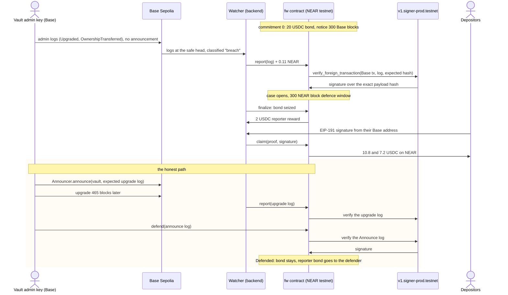
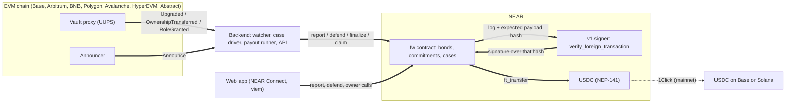

<div align="center">

<picture>
  <source media="(prefers-color-scheme: light)" srcset="web/public/brand/mark-light.png" />
  
</picture>

# Fair Warning

### Give notice, or pay.

Fair Warning lets a DeFi team keep its instant admin key and still give depositors a guarantee with teeth. The team promises N blocks of notice before any upgrade, owner change or role grant, and backs the promise with a USDC bond on NEAR, out of reach of the key it polices. If the key acts without notice, anyone can prove it. NEAR reads the EVM log itself through the MPC network's `verify_foreign_transaction`, and the bond pays the reporter 10% and the depositors 90%. No bridge, no oracle company, no committee we run.

<br/>


-ffd9a0)


**[Live testnet run](#the-full-lifecycle-step-by-step-with-a-real-example)** · **[Check it yourself](#try-it-in-two-minutes)** · **[Deployed contracts](#live-deployment)** · **[What is real](#what-is-real-vs-simulated)** · **[For AI reviewers](AGENTS.md)**

</div>

---

## The problem

Most DeFi vaults can be upgraded by one key. A timelock protects depositors, but teams turn timelocks off because they need emergency speed. Depositors are left trusting that the key will never be used badly, and that it will never leak.

This is not hypothetical:

| What happened | Source | Date |
|---|---|---|
| a16z crypto's Eddy Lazzarin on large vaults without admin time delays: "We've had to relearn this lesson so many times." | [X post](https://x.com/eddylazzarin/status/2036876526780899505) | Mar 25, 2026 |
| S&P Global Ratings launches its Vault Risk Assessment; one of six graded factors is vault security and governance, including who controls changes to the vault | [S&P Global press release](https://press.spglobal.com/2026-10-04-S-P-Global-Ratings-launches-Vault-Risk-Assessment-for-digital-asset-markets) | Oct 4, 2026 |
| A Spark governance proposal sets some Morpho vault timelocks to zero for operational speed | [Governance digest](https://governance.alearesearch.io/item/017117bb-385a-494f-97ce-f97f675ff62a) | Oct 19, 2026 |
| Swell's admin keys are reported compromised, with malicious upgrade contracts queued | [PANews](https://panews.io/articles/01a1617f-6e92-777b-801b-40fa807aa3d7) | Oct 22, 2026 |

A timelock forces the delay. Fair Warning prices skipping it instead: the team keeps its speed, and depositors are paid if the team uses that speed without warning them.

## The solution

1. **Commit.** The team creates a commitment on NEAR: the chain, the watched contract, the admin events, `notice_blocks` and a defence window. It posts a USDC bond with `ft_transfer_call` and commits a Merkle root of depositor balances.
2. **Announce.** Before an admin action, the admin calls `Announcer.announce(target, expectedLog)` on the EVM chain. The `Announce` log commits to the exact log the action will emit.
3. **Report.** If an admin log appears without a matching announcement at least `notice_blocks` earlier, anyone calls `fw.report(log)` with a small NEAR bond. The contract asks `v1.signer` whether that log exists at the required finality, with the exact payload hash it expects. If the MPC network signs that hash, the case opens.
4. **Defend.** During the defence window anyone can prove an earlier valid `Announce` log the same way. An honest upgrade is never punished: the reporter's bond goes to the defender.
5. **Pay.** After the window, `finalize` seizes the bond. The reporter takes 10%. Depositors claim their share by signing an EIP-191 message with the address they deposited from, paid in USDC on NEAR, or delivered to Base or Solana through NEAR Intents 1Click.

**In plain terms:**
- **The team keeps its speed.** No timelock is forced. Skipping the notice costs the bond, it does not block the action.
- **The bond is out of the key's reach.** It sits on NEAR. A leaked admin key on Base cannot touch it.
- **NEAR checks the other chain itself.** The proof is a signature from the NEAR MPC network over the exact log. No bridge, no relayer we run, no price oracle.
- **Depositors claim with the wallet they already have.** One signature from their Base address, no NEAR account needed beforehand, and a relayer cannot redirect the money.

## Try it in two minutes

No keys, no installs, no funds. Everything below reads the live contract on NEAR testnet.

1. **Read the paid-out case.** Case 0 is a breach that went through the real testnet MPC network and paid out:

   ```bash
   curl -s https://rpc.testnet.near.org -H 'content-type: application/json' -d '{"jsonrpc":"2.0","id":1,"method":"query","params":{"request_type":"call_function","finality":"final","account_id":"fw-fw-7ab26a.testnet","method_name":"get_case","args_base64":"eyJjYXNlX2lkIjowfQ=="}}' \
     | python3 -c 'import sys,json;print(bytes(json.load(sys.stdin)["result"]["result"]).decode())'
   ```

   See: `"status":"Paid"`, `"reward":"2000000"`, `"pool":"18000000"`, `"claims":2`, `"reward_paid":true` (USDC has 6 decimals: 2 and 18 USDC).

2. **Read the defended case.** Same command with `case_id` 2 (`args_base64` `eyJjYXNlX2lkIjoyfQ==`). See: `"status":"Defended"`, the honest upgrade whose earlier announcement the MPC network confirmed.
3. **Check a vault is covered right now.** Method `is_covered`, `args_base64` `eyJjb21taXRtZW50X2lkIjoxfQ==` (`{"commitment_id":1}`). See: `true`.
4. **Follow the money on the explorers.** Every transaction of the run is linked in [the lifecycle below](#the-full-lifecycle-step-by-step-with-a-real-example): the Base Sepolia logs on [sepolia.basescan.org](https://sepolia.basescan.org/address/0xC7deE7fBB2c095eA1E321FDc31448b7678FF9B1a) and the NEAR side on [testnet.nearblocks.io](https://testnet.nearblocks.io/address/fw-fw-7ab26a.testnet).
5. **Rebuild the MPC hash yourself.** `cd tools && bun install && bun run check` recomputes the payload hash that `v1.signer` signed on mainnet for a real Base log, in two independent encoders, and gets the same 32 bytes: `fb8f25f6b7bad4ff91af67a7e43f06aaa6653923c8fa6e39d741f220418bbfc5`.

---

## The full lifecycle, step by step, with a real example

Every number below comes from one run on NEAR testnet and Base Sepolia on 10 Nov 2026 (times UTC). The MPC network is the real `v1.signer-prod.testnet` (version 3.18.0), reading Base Sepolia through its own whitelisted RPC providers. Not a mock signer, not a local chain.



**1. Deploy and fund.** The DemoVault proxy, its implementation and the Announcer go to Base Sepolia. Two depositors put real testnet USDC into the vault.
> Real: vault proxy [`0xC7deE7fB…F9B1a`](https://sepolia.basescan.org/address/0xC7deE7fBB2c095eA1E321FDc31448b7678FF9B1a), Announcer [`0x1E4896b1…3814f`](https://sepolia.basescan.org/address/0x1E4896b1042085921373aa7B136cE7C04803814f). Alice deposits 12 USDC ([`0xd8c86857…8c86`](https://sepolia.basescan.org/tx/0xd8c86857bf63bab02388c783cbfc619040e19e5133ede3158e67e55804678c86)), Bob 8 USDC ([`0xbca535c7…4215`](https://sepolia.basescan.org/tx/0xbca535c79a9ead9507a0cffa45a089d9e776efb74425681d9fb3be3a783b4215)).

**2. Commit and bond.** The owner creates commitment 0 (chain Base, notice 300 Base blocks, about 60 s), signs in with NEP-413, registers the vault through the API, commits the depositor root, and posts the bond.
> Real: `create_commitment` at NEAR block 277,097,548 ([`FhuqpLcQ…1ivC`](https://testnet.nearblocks.io/txns/FhuqpLcQUrFZi7vQsKhuEVptHuAcHRLGXc5ZFxpX1ivC)), `set_root` ([`E4Tmp6gH…rsx7`](https://testnet.nearblocks.io/txns/E4Tmp6gHeMNVRTwAvyQPDNMUPs2E7tNikdoyNmz2rsx7)), 20 USDC bond ([`CJw6XpNX…uycW`](https://testnet.nearblocks.io/txns/CJw6XpNXxPmPQP83fVmQGSCXopNFwiPrnJQfEgfPuycW)). `is_covered(0)` returned `true`.

**3. The breach.** The first unannounced admin logs after the commitment's start block were the proxy's own deployment logs (`Upgraded` and `OwnershipTransferred`). We set the start block from the deploy script's simulated block, which was 163 blocks earlier than where the deployment actually landed. The rules make no exception, and neither did the system: both logs are admin actions with no notice.
> Real: Base Sepolia tx [`0xdad6cbe5…9a220`](https://sepolia.basescan.org/tx/0xdad6cbe51214d83999bb90573ebcabd00b1ba0a7f1d679e1c1289103a6c9a220), block 57,047,306, 17:22:10. Commitment start block 57,047,143.

**4. Report and MPC verdict.** The watcher waited for the block to reach Base's `safe` head, then reported it. The contract asked `v1.signer-prod.testnet` to verify the log, and the MPC network answered 10 NEAR blocks later.
> Real: `report` at 17:25:12, NEAR block 277,097,775 ([`2s3NeBdP…6EvQ`](https://testnet.nearblocks.io/txns/2s3NeBdPzGWwU4w9d3f2vQ7mXqwunHyguKVM9csx6EvQ)). Event `defence_opened` at block 277,097,786, 17:25:19, deadline 277,098,086. The second log in the same tx became case 1 ([`FfV7wrAh…5AbY`](https://testnet.nearblocks.io/txns/FfV7wrAhQCpD4MrRERrN4FCTQu7ENL2uLon8ARNN5AbY)) and closed as `Moot`, because only the first breach takes the bond.

**5. Finalize.** Nobody proved a notice before the deadline. Anyone may finalize; the watcher did.
> Real: `finalize` at 17:28:32 ([`ECZ5cyJx…D9X`](https://testnet.nearblocks.io/txns/ECZ5cyJxsGmtZhuKR7G8HKEpRKveU51VfiJdsBUi2D9X)), event `breached` with reward 2 USDC and pool 18 USDC. Reporter reward paid at 17:28:53 ([`BmZi7yXd…ajPL`](https://testnet.nearblocks.io/txns/BmZi7yXdeh9NbRo6CFrPZNTQFTrdxC65ify5jtSQajPL)).

**6. Depositors claim.** Each depositor asked the API for a quote, signed the claim message with their own Base key (EIP-191), and the relayer submitted it. The contract re-checks the signature and the Merkle proof, so the relayer cannot redirect the payout.
> Real: Alice 10.8 USDC to `fw-alice-7ab26a.testnet` at 17:41:01 ([`EaY8b6LW…3RG8`](https://testnet.nearblocks.io/txns/EaY8b6LWKaX9W9Dg8BVFttaDQJN5huEiGtmgYXJC3RG8)), Bob 7.2 USDC to `fw-bob-7ab26a.testnet` at 17:41:05 ([`4t8mfUWw…ZBRx`](https://testnet.nearblocks.io/txns/4t8mfUWwHqZoesW5v5Noj3t9bTikvA42h2GxXU39ZBRx)). Each is exactly 90% of their deposit. Before that, a claim signed over a wrong message was refused with `BAD_SIGNATURE`.

**7. The honest path.** The admin announced an upgrade, waited past the notice, and upgraded. On a second commitment (1, bonded with 2 USDC, start block after the deployment), our watcher reported the upgrade anyway. That was a bug: it scoped announcements to one bond, so it missed the announcement for this one. The owner then proved the announcement, and the MPC network confirmed it.
> Real: announce at Base block 57,048,073, 17:24:43 ([`0x0ccbe3a9…1cd2`](https://sepolia.basescan.org/tx/0x0ccbe3a9ee3e9c8c8ecd85c216c4431e46a2aeb803ae991abde1ca94cceb1cd2)); upgrade at block 57,048,538, 17:26:16, 465 blocks later ([`0xcb1de237…f4d5`](https://sepolia.basescan.org/tx/0xcb1de237695c58ee7fb95129565890501f559318307f823b94ec8f627a89f4d5)). Report at 17:48:22 ([`HXQxWi94…115b`](https://testnet.nearblocks.io/txns/HXQxWi94qz6xNiiaNVZEUbvK2kSwVcpxyMtGPRF6115b)), MPC confirmed the log at 17:48:32. `defend` at 17:49:12 ([`C9gCACsZ…kaKi`](https://testnet.nearblocks.io/txns/C9gCACsZr15HPDw6ScWhxrpoeL9X4XqpZUJo6AgmkaKi)), event `defended` 11 blocks later. The bond stayed; the reporter's 0.1 NEAR went to the defender. The watcher bug is fixed, with regression tests in `backend/test/watcher.integration.test.ts`.

**8. One breach, two bonds (after the security upgrade).** Two bonds police the same vault: commitment 1 and commitment 2, 2 USDC each. The admin upgraded with no announcement. Our watcher reported it against commitment 1; a second, independent watcher (`fw-bob-7ab26a.testnet`) reported the same log against commitment 2. Before the upgrade, the contract would have refused the second report, which let a decoy bond shield a real one.
> Real: upgrade at Base block 57,481,268, 17:28:43 on 12 Nov 2026 ([`0x5c3aa5b2…5f30`](https://sepolia.basescan.org/tx/0x5c3aa5b23a44c18e33025fc4f4f2fc9d0e78bf646d18d1f58a8737382bf75f30)). Case 3 reported at 17:33 ([`9b8j8r2K…mBFT`](https://testnet.nearblocks.io/txns/9b8j8r2K2BYLvVXZHwdnwCid5G6r1QToBdbDK8LRmBFT)); case 4 at 17:33:52 ([`GgqUta9i…TUH1`](https://testnet.nearblocks.io/txns/GgqUta9ipQMJkoywxgAnkNGytnDqrzpdUeXdfq1VTUH1)), MPC-confirmed in the same transaction. Both `Breached` at 17:36:55 and `Paid` at 17:37:47, nine minutes after the upgrade. Each bond paid 0.2 USDC to its reporter, 1.08 USDC to Alice and 0.72 USDC to Bob.

---

## Live deployment

| Surface | Where |
|---|---|
| `fw` contract (NEAR testnet) | [`fw-fw-7ab26a.testnet`](https://testnet.nearblocks.io/address/fw-fw-7ab26a.testnet), code hash `2Tuu83XL97AmVMmAZdSiz5o6o9yBGH96HqtHoBovF7F9` (security upgrade [`8gBmfmsV…9HYZ`](https://testnet.nearblocks.io/txns/8gBmfmsVQd2Hsz7Btagkypg2YECWBw7YM5qftZYb9HYZ); the cases above ran on `H5mJNsj1…uUrkt`) |
| MPC network | `v1.signer-prod.testnet` (near/mpc 3.18.0), domain 3 key `secp256k1:2KGCoy2p…32qj1` |
| Bond token | Circle USDC on NEAR testnet, `3e2210e1184b45b64c8a434c0a7e7b23cc04ea7eb7a6c3c32520d03d4afcb8af` |
| DemoVault proxy (Base Sepolia) | [`0xC7deE7fBB2c095eA1E321FDc31448b7678FF9B1a`](https://sepolia.basescan.org/address/0xC7deE7fBB2c095eA1E321FDc31448b7678FF9B1a) |
| Announcer (Base Sepolia) | [`0x1E4896b1042085921373aa7B136cE7C04803814f`](https://sepolia.basescan.org/address/0x1E4896b1042085921373aa7B136cE7C04803814f) |
| Commitments | 0, 1, 2: breached and paid out. 3 and 4: covered, 2 USDC each, policing the same vault from Base block 57,491,651 |
| Accounts | owner `fw-owner-7ab26a.testnet`, watcher `fw-watch-7ab26a.testnet` |
| Web app and API | Run locally (below). No hosted deployment yet |

The testnet wasm was built with `cargo near build non-reproducible-wasm`. The reproducible build (`sourcescan/cargo-near:0.22.0-rust-1.97.1`, pinned by digest) is configured in `contracts/near/contract/Cargo.toml`; mainnet will use it.

---

## The stack

| Layer | Technology |
|---|---|
| NEAR contract | Rust 1.97.1, near-sdk 5.29.1, near-contract-standards 5.29.1, near-mpc-sdk (near/mpc tag 3.17.0, wire types unchanged in 3.18.0), cargo-near 0.22.0 |
| EVM contracts | Solidity 0.8.30, OpenZeppelin Contracts and Contracts Upgradeable 5.7.0, Foundry 1.8.3 |
| Backend | Bun 1.4, Fastify 5, Prisma 7 on PostgreSQL, near-api-js 7.4.0, viem 2.57.11, @openzeppelin/merkle-tree 1.0.8 |
| Web | TanStack Start (React 19), TanStack Router and Query, Tailwind 4, GSAP, Lenis, @hot-labs/near-connect 0.12.0, viem |
| Cross-checks | Python and TypeScript payload encoders, plus the official Rust SDK types, in `tools/` |

---

## NEAR integrations

### Read MPC: `v1.signer.verify_foreign_transaction`
The contract builds the request with the official SDK builder for the commitment's chain, sends it to `v1.signer` with yield/resume, and accepts the case only if the MPC network signed the exact payload hash it expected. The same check runs locally from a signature (`report_verified`, `defend_verified`) in case contract callbacks change.
Key files: `contracts/near/contract/src/lib.rs` (`report`, `defend`, `on_breach_verified`, `on_defence_verified`, `build_request`)

### Seven EVM chains, one bond on NEAR
The MPC network reads Base, Arbitrum, BNB Chain, Polygon, Avalanche, HyperEVM and Abstract on both mainnet and testnet (`get_available_foreign_chains`, checked 10 Nov 2026). A commitment names its chain. The MPC request, the backend watcher (one cursor per chain), the explorer links and the notice durations (block time measured from the chain) all follow it. A sandbox test proves a signature for the same log on another chain cannot open a case.
Key files: `contracts/near/contract/src/lib.rs` (`EvmChain`) · `backend/src/lib/fw/base.ts` · `backend/src/workers/baseLogWatcher.ts`

### An independent payload encoder
The backend rebuilds the borsh payload the MPC network signs and its sha256, without the SDK. A test pins it to the hash `v1.signer` signed on mainnet for a real Base log, and to the SDK's output for every one of the seven chains.
Key files: `backend/src/lib/fw/mpcPayload.ts` · `backend/test/fw.test.ts` · `tools/`

### NEP-141 bonds and payouts, NEP-297 events
Bonds arrive through `ft_on_transfer`. Payouts register storage and `ft_transfer`. Every state change emits a `fair_warning` 1.0.0 event; the backend settles payouts from the claim transaction's own events.
Key files: `contracts/near/contract/src/lib.rs` · `backend/src/lib/fw/near.ts` · `backend/src/workers/payoutRunner.ts`

### NEAR Intents 1Click
On mainnet, a depositor can take their share as USDC on Base or Solana: the claim pays a 1Click deposit address. Intents has no testnet, so on testnet the app shows a real mainnet quote for the share as a labelled dry run (`dry: true`) and pays on NEAR.
Key files: `backend/src/lib/fw/oneClick.ts` · `backend/src/routes/fwRoutes.ts` (`/claims/quote`, `/claims/preview`)

### NEP-413 sign-in and NEAR Connect
Vault owners sign in with a NEP-413 message checked against a full-access key of their account. The web app signs reports, defences and owner calls through NEAR Connect.
Key files: `backend/src/routes/authRoutes.ts` · `web/src/lib/near/wallet.ts`

---

## Repo layout

| Path | What |
|---|---|
| [`contracts/near`](contracts/near/README.md) `contract` | The `fw` contract: commitments, bonds, cases, MPC calls, payouts |
| `contracts/near/sandbox-tests` | One near-workspaces test per security claim (16), plus 4 audit proof-of-concept tests |
| `contracts/near/mock-signer`, `mock-ft` | Test doubles for `v1.signer` (same method and yield/resume, a known key) and USDC |
| [`contracts/base`](contracts/base/README.md) | `Announcer`, `DemoVault` (UUPS), deploy and action scripts. 9 Foundry tests, including a 256-run fuzz test |
| [`backend`](backend/README.md) | Watcher, case driver, payout runner, REST API. 76 tests |
| [`web`](web/README.md) | Landing page, vault index, vault page, report, case and bond flows |
| [`tools`](tools/README.md) | The MPC payload hash rebuilt in Python, TypeScript and Rust |
| [`AGENTS.md`](AGENTS.md) | Commands, map and invariants for AI reviewers |

---

## Run locally

Prerequisites: Rust via rustup (the contracts pin 1.97.1 in `rust-toolchain.toml`), `cargo-near` 0.22.0, Foundry 1.8.3, Bun 1.4, PostgreSQL 15.

**1. NEAR contract, the whole breach and payout flow on a local sandbox** (a mock signer plays the MPC network with a real secp256k1 key):

```bash
cd contracts/near
for c in mock-signer mock-ft contract; do (cd $c && cargo near build non-reproducible-wasm --no-abi); done
cd sandbox-tests && cargo test -- --test-threads=4
```

See: `test result: ok. 16 passed` (2 to 7 minutes; the timeout and withdrawal tests fast-forward up to 1,000 blocks). `cargo clippy --target wasm32-unknown-unknown -- -D warnings` in `contracts/near/contract` passes.

**2. EVM contracts:**

```bash
cd contracts/base
forge install foundry-rs/forge-std OpenZeppelin/openzeppelin-contracts@v5.7.0 OpenZeppelin/openzeppelin-contracts-upgradeable@v5.7.0 --no-git
forge test
```

See: `9 tests passed`, including a 256-run fuzz test that the announced action hash equals the real upgrade log.

**3. Backend tests:**

```bash
cd backend && bun install
createdb fw_test
export DATABASE_URL=postgresql://$USER@localhost:5432/fw_test
bunx prisma db push --config prisma/prisma.config.ts && bunx prisma generate --config prisma/prisma.config.ts
BASE_RPC_URL=https://mainnet.base.org FW_CONTRACT_ID=fw.test.near WATCHER_ACCOUNT_ID=w.test.near \
WATCHER_PRIVATE_KEY=ed25519:3D4YudUahN1nawWogh8pAKSj92sUNMdbZGjn7kERKzYoTy8tnFQuwoGUC51DowKqorvkr2pytJSnwuSbsNVfqygr \
JWT_SECRET=test bun test
```

See: `76 pass`. The private key above is a throwaway test value that is never used on a network.

**4. Payload hash cross-check:** `cd tools && bun install && bun run check` prints `fb8f25f6…bfc5` twice and exits 0. `cd tools/hashcheck && cargo run --release` adds the official Rust SDK types and prints the hash for each of the seven chains.

**5. The app against testnet.** Copy `backend/.env.example` and `web/.env.example`, then set these:
- **Chains and network:** `NEAR_NETWORK=testnet`, `BASE_NETWORK=baseSepolia`, `BASE_RPC_URL=https://sepolia.base.org`.
- **Contracts:** `FW_CONTRACT_ID=fw-fw-7ab26a.testnet`, and `USDC_CONTRACT_ID` to the Circle testnet USDC above.
- **Watcher:** `WATCHER_ACCOUNT_ID` and `WATCHER_PRIVATE_KEY`, a testnet account of your own holding about 1 NEAR. It reports, finalizes and relays claims.
- **Web:** `VITE_NEAR_NETWORK=testnet`, `VITE_FW_CONTRACT_ID` and `VITE_USDC_CONTRACT_ID` with the same values.

Then `bun index.ts` in `backend` and `bun dev` in `web`, and open http://localhost:3200.

| Page | What it does |
|---|---|
| `/` | The story: a live notice clock on Base blocks, a breach followed from Base through the MPC network to the payouts |
| `/bonds` | Every bonded vault as a lamp on one coastline, live totals, the ledger and recent cases |
| `/bonds/$slug` | One vault: its chain and promise, a live notice dial for any announced change, every admin action and case |
| `/report` | Paste a transaction from any watched chain, see the exact hash the MPC network will sign, sign `fw.report`. "Try a real one" checks indexed logs with no wallet |
| `/cases/$caseId` | A case moving from report to payout; depositors claim with an EIP-191 signature |
| `/bond/new` | Owners pick the chain, create the commitment, sign in (NEP-413), register, commit the depositor root and post the bond |

---

## Architecture



The backend is a convenience, not a trust root. Anyone can call `report`, `defend`, `finalize` and `claim` directly; the contract checks everything itself, and the case state on NEAR is the source of truth the backend mirrors.

---

## Claims and where to check them

| Claim | Evidence |
|---|---|
| An unannounced admin change pays the reporter and depositors | sandbox `breach_without_notice_pays_reporter_and_depositors`; live case 0 above |
| An honest, announced change is never punished | sandbox `honest_upgrade_is_defended_and_reporter_bond_goes_to_defender`; live case 2 above |
| Short notice, a different action or a stale announcement does not count as a defence | sandbox `defence_rules_notice_action_window` |
| A signature for the same log on another chain cannot open a case | sandbox `the_commitment_chain_binds_the_mpc_answer` |
| A decoy bond on the same vault cannot shield the real bond | sandbox `two_commitments_on_one_log_both_open_cases` (in `audit_poc.rs`); live cases 3 and 4 above |
| A false report cannot pay out; it times out and refunds | sandbox `wrong_claim_times_out_and_refunds` (real 200-block yield timeout) |
| The bond cannot be withdrawn without notice or during a case | sandbox `bond_withdrawal_needs_notice_and_no_open_case` |
| A pending withdrawal shows as not covered, and a breach just before it can still be reported | sandbox `withdrawal_waits_for_notice_plus_grace_and_ends_coverage` |
| A relayer cannot redirect or replay a depositor's claim | sandbox `claims_cannot_replay_or_redirect`; backend 401 test; live `BAD_SIGNATURE` refusal |
| One protocol's bad Merkle root cannot pay out another protocol's bond | sandbox `a_lying_root_total_cannot_drain_other_bonds` |
| Our payload hash equals what the MPC network signs, on every supported chain | backend `fw.test.ts`; `tools/` in Python, TypeScript and Rust |
| A shared Announcer serves many vaults without dropping announcements | backend `watcher.integration.test.ts` |
| It still works if contract callbacks break | sandbox `fallback_a_direct_signature_path` |
| Reports pay for their storage, and only a full-access key can run owner methods | sandbox `reports_pay_their_storage_and_owner_calls_need_full_access` |
| The watcher keeps up behind providers that cap `eth_getLogs` ranges | backend `baseLogs.test.ts` |

---

## What is real vs simulated

| Area | Status |
|---|---|
| `fw` contract on NEAR testnet, MPC verification, bonds, cases, payouts | **Live** since 10 Nov 2026. Real `v1.signer-prod.testnet`, real Circle testnet USDC |
| Breach, report, verdict, finalize, depositor claims | **Live**, case 0; and cases 3 and 4 on the upgraded contract |
| One log slashing every bond that polices it, with an independent reporter | **Live**, cases 3 and 4 |
| Honest upgrade and defence | **Live**, case 2 |
| DemoVault and Announcer on Base Sepolia | **Live.** The vault is a demo vault we control, so we hold the admin key being policed |
| Depositors | Two test wallets we control, with real testnet USDC deposits |
| Watcher, case driver, payout runner | **Real**, run locally against testnet |
| NEAR Intents payouts to Base and Solana | **Mainnet only.** On testnet: real dry-run quotes, payouts on NEAR |
| Arbitrum, BNB, Polygon, Avalanche, HyperEVM, Abstract | **Supported and tested** (contract, encoder, watcher). The live run used Base Sepolia only |
| Mainnet | **Not deployed** |

---

## Security

- One near-workspaces test per security claim (16) plus 4 audit proof-of-concept tests, 9 Foundry tests with fuzzing, 76 backend tests. `cargo clippy -D warnings` is clean.
- Contract hardening follows the [NEAR security checklist](https://docs.near.org/smart-contracts/security/checklist.md):
  - owner methods need exactly 1 yoctoNEAR;
  - reports pay a non-refundable 0.01 NEAR storage fee (559 bytes measured per full case);
  - log data and proofs are size-capped;
  - payouts per case are capped at that case's pool.
- The live run found five backend bugs; all are fixed and the risky ones have regression tests:
  - **Shared Announcer:** announcements were scoped to one bond.
  - **Late-registered vaults** were never backfilled.
  - **Stored verdicts** never updated on a re-scan.
  - **Payouts stayed `submitted`** without the event indexer.
  - **A start block before the real deployment** counted the deploy's own logs as a breach.
- Limits, stated plainly:
  - **The depositor root is committed by the team.** A rogue team can commit a bad root in advance. It is public and frozen while a case is open, and each case's payouts are capped at its own pool.
  - **Only the admin events a team declares are policed.** A `setOracle` call or a fee switch outside `watched_topics` is invisible.
  - **Read MPC is new and moving.** We pin the 3.17.0 SDK types, which are unchanged in 3.18.0. The local signature check is kept in case contract callbacks change.
  - **Liveness depends on the MPC network's RPC providers.** It needs 2 of its 3 whitelisted providers per chain to agree. An outage delays a verdict; it cannot fake one.
  - **Notice is counted in EVM blocks, the defence window in NEAR blocks.** There are no timestamps. Base produces a block about every 0.2 s (measured 10 Nov 2026), so 24 hours of notice is about 432,000 blocks.
  - **Coverage ends when a withdrawal is requested.** The bond leaves only after `withdrawal_notice` plus a grace period (600 NEAR blocks for `Safe`, 3,000 for `Finalized`), so a breach from before the notice ended can still be proven.
  - **The bond is a penalty, not insurance.** The team chooses its size.
  - **The watcher needs a Base RPC that serves `eth_getLogs`.** `mainnet.base.org` refused it in our tests; `sepolia.base.org` allows 200 blocks per call; the watcher adapts to any range cap.

---

## Submission

NEAR HACKATHON (1 to 14 Nov 2026). Tracks: `defi`, `open`.

| Field | Value |
|---|---|
| Project | Fair Warning |
| Tracks | `defi` (Unstoppable DeFi), `open` (Open Innovation) |
| Testnet contract | [`fw-fw-7ab26a.testnet`](https://testnet.nearblocks.io/address/fw-fw-7ab26a.testnet) |
| Repository | [github.com/capinhoooo/fairwarning](https://github.com/capinhoooo/fairwarning) |
| Demo video | Published with the X post |

### What existed before, and what we used

- **Baseline:** the `backend` and `web` folders start from our own pre-hackathon Kwek Labs starters (Fastify + Prisma, and TanStack Start). Everything else was written for this hackathon, starting 26 Oct 2026, inside the window that opened with the announcement on 19 Oct 2026:
  - `backend/src/lib/fw`, `backend/src/workers` (except `errorLogCleanup.ts`), and `backend/src/routes` (except `exampleRoutes.ts`);
  - `web/src/lib`, `web/src/hooks`, the Fair Warning components and every page;
  - all of `contracts/` and `tools/`.
- **Starter files, unchanged** (byte-for-byte, checked against the starters):
  - `backend`: `src/utils/{errorHandler,miscUtils,timeUtils,validationUtils}.ts`, `src/middlewares/authMiddleware.ts`, `src/routes/exampleRoutes.ts`, `src/workers/{exampleWorkers,errorLogCleanup}.ts`, `dotenv.ts`, `prisma/prisma.config.ts` and the lint, format and TypeScript config;
  - `web`: `src/router.tsx`, `src/env.ts`, `src/lib/polyfills.ts`, `src/utils/style.ts`, `src/integrations/tanstack-query/*`, `src/providers/{HeroUIProvider,ThemeProvider}.tsx`, `FRONTEND_STRUCTURE_GUIDE.md` and the lint, format and TypeScript config.
  
  Every other file was written or rewritten for this hackathon. The repository was published as one history on 14 Nov 2026.
- **Libraries:** near-sdk, near-contract-standards, near-mpc-sdk, near-workspaces, OpenZeppelin Contracts and Contracts Upgradeable, forge-std, near-api-js, @hot-labs/near-connect, viem, @openzeppelin/merkle-tree, Fastify, Prisma, TanStack, GSAP, Lenis (versions in [the stack](#the-stack)).
- **Other project:** some of us also built **Secret Shopper** (tracks `security`, `business`) at this hackathon. It is an independent project with its own repository and no shared code.

---

## Disclaimers

- **Testnet only.** Testnet USDC and NEAR have no value. Do not send mainnet funds to any address in this README.
- **The live breach was our own configuration mistake.** Case 0 was triggered by the vault's deployment logs, because we set the commitment's start block too early. It shows the rule working as written, and the web app sets the start block from the live head to avoid it.
- **The demo vault and depositors are ours.** We hold the admin key being policed and the depositor keys.

## License

MIT, see [LICENSE](LICENSE).

## AI use

Built with Claude Code as a pair programmer for research, design, code, tests, documentation and the live testnet run. Every claim and number in this README was checked against the deployed contracts, the code, the test output or a cited source before it was written.
