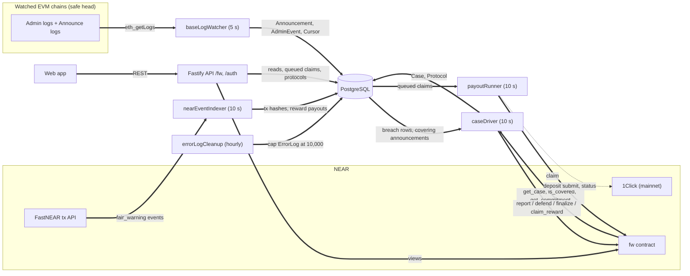

<div align="center">
<picture>
  <source media="(prefers-color-scheme: light)" srcset="../web/public/brand/mark-light.png" />
  
</picture>

# Fair Warning · Backend

### Watches the chains, mirrors the contract, relays the claims.

The backend reads admin and `Announce` logs on the watched EVM chains, classifies each admin log as announced or breach, and reports, defends and finalizes cases on the `fw` contract. It relays depositor claims and serves the REST API the web app reads. It holds no funds and decides nothing: the contract on NEAR checks every call itself.

<br/>


**[Root README](../README.md)** · **[Run locally](../README.md#run-locally)** · **[Architecture](../README.md#architecture)** · **[Security](../README.md#security)** · **[Payload cross-check](../tools/README.md)** · **[For AI reviewers](../AGENTS.md)**

</div>

---

## Why it is a convenience, not a trust root

Anyone can call `report`, `defend`, `finalize` and `claim` on `fw-fw-7ab26a.testnet` directly. The contract asks `v1.signer-prod.testnet` to verify each log, checks the depositor's EIP-191 signature and Merkle proof, and caps every payout at the case's pool. The backend only saves people the work:

- **Case state comes from the chain.** `caseDriver` mirrors `get_case` and `is_covered` before acting. The database is an index, never the source of truth.
- **A wrong verdict costs the watcher, not depositors.** If the backend reports an announced change, the owner defends it and the reporter's bond goes to the defender (live case 2 in the [root README](../README.md#the-full-lifecycle-step-by-step-with-a-real-example)).
- **A relayer cannot redirect a claim.** The depositor signs `pay_to`; the API checks the signature, then the contract checks it again.
- **A second, independent watcher works the same way.** Live cases 3 and 4 were reported by two different accounts against two bonds on one log.

## Quick check

| Do | See |
|:-|:-|
| `cd backend && bun install`, then the test commands in [Tests](#tests) | `76 pass` |
| `bun index.ts` with the testnet env from [root step 5](../README.md#run-locally), then `curl -s localhost:3700/` | `{"success":true,"message":"Hello there!","error":null,"data":null}` |
| `curl -s localhost:3700/fw/heads` | `base`, `baseSafe`, `near` block heights and a `chains` map |
| `curl -s localhost:3700/fw/cases/0` | `data.chain` is the live `get_case` view: `"status":"Paid"` on `fw-fw-7ab26a.testnet`, even before your index holds the case |

---

## Architecture



All five workers start from `index.ts`. Each has an `isRunning` guard, so a slow tick is skipped, never run twice in parallel. One watcher `Account` is shared by every worker so the NEAR nonce manager is shared too.

---

## Workers

### `baseLogWatcher`: classify admin logs
**Schedule:** every 5 s (`*/5 * * * * *`), plus once at startup.
**Reads:** `Protocol` rows with `status = Committed` and `covered = true`; for each served chain, `eth_getLogs` on the watched addresses and Announcers, filtered to the commitments' `watchedTopics` plus the `Announce` topic, up to that chain's `safe` head.
**Writes:** `Announcement`, `AdminEvent` (verdict `announced` or `breach`), `Cursor`.

- **One cursor per chain.** Ids are `base:<BASE_NETWORK>` for Base and `<chain>:<BASE_NETWORK>` for the others. One slow or failing chain does not stall the rest.
- **Adaptive ranges.** Reads start at `BASE_LOG_CHUNK` blocks per call and halve on a provider range error, down to 10. Rate-limit errors do not shrink the chunk. At most 20 calls per chain per tick.
- **One row per (bond, log).** Every covered bond whose addresses, topic0 and start block match a log gets its own `AdminEvent`, so each bond can open its own case.
- **Announcements match on (Announcer, target), not on one bond.** An `Announce` is skipped unless it has three topics, its data decodes as `bytes`, `keccak256(expectedLog)` equals `topics[1]`, and `expectedLog` starts with the target address. Those are the logs `fw.defend` would refuse.
- **Re-scans update verdicts.** A breach row becomes `announced` if a covering announcement is indexed later.
- **Poison-log skip.** A log whose handling throws holds the cursor below it and is retried. After 3 failures it is skipped, so one bad log cannot freeze the chain.
- **First scan and rewinds are capped.** A new cursor starts at the earliest `effectiveFromBlock - maxAnnounceAgeBlocks` of its bonds, never more than `MAX_BACKFILL_BLOCKS` behind the safe head. The cursor moves by compare-and-set, so a rewind made during a tick wins over that tick.

### `caseDriver`: mirror the chain, then act
**Schedule:** every 10 s (`*/10 * * * * *`).
**Reads:** `next_case`, `get_case` for every live case and every new id, `get_commitment` and `is_covered` for every `Committed` protocol.
**Writes:** `Case`, `AdminEvent.caseId`, `Protocol.bond/status/covered`, and NEAR transactions.

1. **Sync.** Upserts each case from `get_case` and links it to its own bond's `AdminEvent`. Updates bond, status and coverage. When a bond flips from uncovered to covered, it rewinds that chain's cursor (capped by `MAX_BACKFILL_BLOCKS`) before saving the flip, so a failed rewind is retried next tick.
2. **Report** (only when `AUTO_REPORT` is not `false`). Takes up to 20 `breach` rows with no case (or a `Rejected` one), oldest block first, on covered `Committed` bonds. Skips topics the commitment does not watch. Waits until the log is at or below the bond's own finality head (`Safe` or `Finalized`), then calls `report` with the deposit from `report_deposit`. At most 3 attempts per row.
3. **Defend.** For each `DefenceOpen` case with no pending defence, before the deadline, it looks up a covering announcement that has reached finality and calls `defend`. At most 3 attempts, 60 s apart.
4. **Finalize.** Calls `finalize` on `DefenceOpen` cases past their deadline, then `claim_reward` on `Breached` cases with a non-zero unpaid reward (at most 3 attempts).

`AUTO_REPORT=false` lets a human be the first reporter; defend and finalize still run.

### `nearEventIndexer`: event history
**Schedule:** every 10 s, plus once at startup. Disabled while `INDEXER_START_HEIGHT` is unset.
**Reads:** the FastNEAR Transactions API for transactions received by `FW_CONTRACT_ID`, from its cursor up to the final height minus 250 blocks (covers the 200-block MPC yield), at most 2,000 blocks per tick. Only `fair_warning` events from successful receipts count.
**Writes:** `Case` rows for `reported`, `defenceTxHash` on `defended`, `finalizeTxHash` on `breached`, reward `Payout` rows and depositor payout status on `paid` / `payout_failed`. Cursor id `near:<NEAR_NETWORK>:<FW_CONTRACT_ID>`.

It never sets case status beyond the initial `Reported`: this feed lags, and `caseDriver` owns live state. Handlers are idempotent, so a crash only replays one window.

### `payoutRunner`: relay depositor claims
**Schedule:** every 10 s.
**Reads/writes:** `Payout`.

1. **Relay.** Takes up to 5 `queued` depositor payouts, marks them `submitted`, signs `claim`, and stores the tx hash before sending. The claim's own receipts settle it as `paid` or `failed`; the event indexer is optional.
2. **Reconcile.** Re-reads up to 10 `submitted` payouts from the chain. A tx the RPC still does not know after 10 minutes is marked `failed`; a late landing cannot pay twice because the contract marks the leaf claimed.
3. **1Click.** For paid `1click` payouts, submits the deposit to 1Click and follows its status: `SUCCESS` becomes `bridged`, `REFUNDED` or `FAILED` becomes `failed`.

Payout statuses: `queued`, `submitted`, `paid`, `bridged`, `failed`.

### `errorLogCleanup`
**Schedule:** hourly (`0 * * * *`), plus once at startup. Deletes the oldest `ErrorLog` rows above 10,000.

---

## REST API

Base URL `http://localhost:3700` by default. Routes are registered under `/fw` and `/auth`. Auth "JWT" means `Authorization: Bearer <token>` from `POST /auth/verify`.

### `/auth`

| Method | Path | Purpose | Auth |
|:-|:-|:-|:-|
| POST | `/auth/nonce` | Body `{ accountId }`. Returns `{ nonce, recipient: "fairwarning.app", message: "Sign in to Fair Warning" }` for a NEP-413 signature | none |
| POST | `/auth/verify` | Body `{ accountId, publicKey, signature }`. Verifies the NEP-413 signature and that `publicKey` is a full-access key of `accountId`. Returns `{ token, accountId }` | none |

### `/fw`

| Method | Path | Purpose | Auth |
|:-|:-|:-|:-|
| GET | `/fw/heads` | Base head and `safe` head, NEAR final height, and heads of other chains with a bonded protocol. Cached 3 s | none |
| GET | `/fw/stats` | Protocol count, covered count, total bonded, open cases, total paid out | none |
| GET | `/fw/chains` | Served chains with chain id, name, explorer and measured block time (average over the last 1,000 blocks) | none |
| GET | `/fw/protocols` | All registered protocols with announcement and case counts | none |
| GET | `/fw/protocols/:slug` | One protocol, its latest 50 admin events, 20 cases and 50 announcements | none |
| GET | `/fw/admin-events` | The 6 newest policed admin logs, one entry per log | none |
| GET | `/fw/announcements/latest` | Newest announcement and a bond it serves, for the notice clock | none |
| GET | `/fw/cases` | The 30 newest cases with their vault name | none |
| GET | `/fw/cases/:caseId` | Indexed case, its protocol and payouts, plus `chain` (the live `get_case` view, `null` if NEAR RPC fails) | none |
| GET | `/fw/cases/by-log/:commitmentId/:txHash/:logIndex` | Case id the contract holds for this log under this commitment (`case_for_log`) | none |
| POST | `/fw/report/prepare` | Body `{ txHash, chain? }`. For each policed log in the tx and each bond policing it: verdict, open case, expected MPC payload hash, `fw.report` args with deposit, and a direct `verify_foreign_transaction` fallback | none |
| POST | `/fw/claims/quote` | Body `{ caseId, baseAddress, route: near\|base\|sol, recipient }`. Share, Merkle proof, `pay_to` and the exact message to sign. Off mainnet, `base`/`sol` return a real mainnet 1Click quote with `dryRun: true` and no message | none |
| POST | `/fw/claims/preview` | Body `{ amount, route: base\|sol, recipient }`. `dry: true` 1Click quote; moves nothing | none |
| POST | `/fw/claims` | Body `{ caseId, baseAddress, payTo, route, signature }`. Verifies the EIP-191 signature against `claim_message_for`, checks the leaf, queues a payout. One per (case, address); only a `failed` claim that never reached 1Click can be queued again | EIP-191 in body |
| GET | `/fw/payouts/:id` | One payout and its status | none |
| POST | `/fw/protocols` | Body `{ commitmentId, slug, name }`. Registers an on-chain commitment; caller must be its owner. Rewinds the chain cursor if the bond is already covered | JWT |
| POST | `/fw/protocols/:slug/root` | Body `{ snapshotBlock?, balances: [{ address, amount }] }`. Builds the depositor Merkle tree and returns `setRootArgs` for `fw.set_root`. Owner only; refused (`ROOT_LOCKED`) while a case is open or after the bond is spent | JWT |

`GET /` is the health check. `/example` is a starter placeholder with no routes.

### Response envelope

```json
{ "success": true, "error": null, "data": { } }
```

```json
{ "success": false, "error": { "code": "NOT_CLAIMABLE", "message": "Case is not paying out" }, "data": null, "timestamp": "2026-11-10T17:41:01.000Z" }
```

BigInt fields are sent as strings. One exception to the envelope: a missing required body field is answered by `validateRequiredFields` as `{ statusCode: 400, error: "Bad Request", message }`. Error codes in use include `INVALID_TX_HASH`, `CHAIN_NOT_SERVED`, `NO_ADMIN_LOG`, `BAD_SIGNATURE`, `NOT_CLAIMABLE`, `ROOT_NOT_INDEXED`, `CLAIM_EXISTS`, `SLUG_TAKEN`, `ALREADY_REGISTERED`, `ROOT_LOCKED`, `NONCE_EXPIRED`, `RATE_LIMITED` and `INTERNAL_ERROR`.

Key files: `index.ts` · `src/routes/fwRoutes.ts` · `src/routes/authRoutes.ts` · `src/utils/errorHandler.ts` · `../web/src/lib/api/fw.ts` (the typed client)

---

## Data model

Schema: `prisma/schema.prisma` (PostgreSQL, Prisma 7 with the `pg` adapter).

| Model | Holds | Keys |
|:-|:-|:-|
| `Protocol` | One registered commitment: chain, `vaultAddress` (watched[0], for display), `watchedAddresses`, `watchedTopics`, `announcerAddress`, owner, `noticeBlocks`, `maxAnnounceAgeBlocks`, `effectiveFromBlock`, finality, `defenceWindow`, bond, status, `covered` | unique `commitmentId`, unique `slug` |
| `Announcement` | One `Announce` log: `actionHash`, `expectedLog`, block, and the full `log` as `fw.defend` takes it | unique (`txHash`, `logIndex`) |
| `AdminEvent` | One policed admin log per bond: topic0, fingerprint, the full `log` as `fw.report` takes it, verdict, linked announcement and case | unique (`protocolId`, `txHash`, `logIndex`) |
| `Case` | Mirror of `get_case`: status, action hash, breach block, deadline, reward, pool, `rewardPaid`, `pendingDefences`, defence and finalize tx hashes | unique `caseId` |
| `BeneficiaryRoot` | A depositor Merkle root, total, leaf count, snapshot block and the `StandardMerkleTree` dump | unique (`protocolId`, `root`) |
| `Payout` | A reward or depositor payout: amount, leaf amount, `payTo`, route (`near` or `1click`), signature, proof, tx hash, 1Click status | unique (`caseId`, `kind`, `baseAddress`) |
| `Cursor` | Last block read per chain, or last NEAR height indexed | `id` |
| `User` | NEP-413 sign-in: account, single-use nonce and its issue time | unique `walletAddress` |
| `ErrorLog` | Server-side error records (code, status, stack, request info) | indexed by code and time |

`watchedAddresses` and `watchedTopics` are stored lowercase with `0x`. Rows registered before those columns existed have them empty and fall back to `vaultAddress` and the fixed `Upgraded`, `OwnershipTransferred` and `RoleGranted` topics; `scripts/backfill-watched.ts` fills them.

---

## Environment

Config is read only in `src/config/main-config.ts`. The six required variables stop startup if missing. `.env.example` lists `APP_PORT`, `NODE_ENV`, `DATABASE_URL`, `JWT_SECRET` and `JWT_EXPIRES_IN`; the [root README step 5](../README.md#run-locally) lists the testnet values.

| Variable | Required | Default | Purpose |
|:-|:-|:-|:-|
| `DATABASE_URL` | yes | | PostgreSQL connection string |
| `JWT_SECRET` | yes | | Signs owner session tokens |
| `BASE_RPC_URL` | yes | | Base RPC; must serve `eth_getLogs` |
| `FW_CONTRACT_ID` | yes | | The `fw` contract, e.g. `fw-fw-7ab26a.testnet` |
| `WATCHER_ACCOUNT_ID` | yes | | NEAR account that reports, finalizes and relays claims |
| `WATCHER_PRIVATE_KEY` | yes | | Its key (`ed25519:...`) |
| `APP_PORT` | | `3700` | HTTP port |
| `NODE_ENV` | | `development` | `production` hides error details (see [Security](#security)) |
| `JWT_EXPIRES_IN` | | `7d` | Token lifetime |
| `BASE_NETWORK` | | `base` | `baseSepolia` switches every EVM chain to its testnet |
| `BASE_LOG_CHUNK` | | `200` | Starting `eth_getLogs` span in blocks |
| `EVM_RPC_URLS` | | `{}` | JSON map of other chains to RPC URLs, e.g. `{"Arbitrum":"https://..."}`. A chain is served only if it has an entry (Base always is) |
| `MAX_BACKFILL_BLOCKS` | | `1000000` | Deepest rewind behind the safe head |
| `NEAR_NETWORK` | | `mainnet` | `testnet` switches NEAR defaults |
| `NEAR_RPC_URL` | | `https://free.rpc.fastnear.com` (mainnet), `https://test.rpc.fastnear.com` (testnet) | NEAR RPC |
| `MPC_CONTRACT_ID` | | `v1.signer` (mainnet), `v1.signer-prod.testnet` (testnet) | Used in the report fallback args |
| `USDC_CONTRACT_ID` | | `17208628f84f5d6ad33f0da3bbbeb27ffcb398eac501a31bd6ad2011e36133a1` (mainnet USDC) | Bond token; set the Circle testnet id on testnet |
| `AUTO_REPORT` | | on | `false` stops automatic reports only |
| `FASTNEAR_API_KEY` | | empty | Bearer key for FastNEAR RPC and tx API |
| `INDEXER_START_HEIGHT` | | `0` (indexer off) | NEAR height to start event history, normally the `fw` deploy block |
| `CORS_ORIGINS` | | `http://localhost:3200` | Comma-separated allowlist |
| `ONECLICK_API_URL` | | `https://1click.chaindefuser.com` | 1Click API |
| `ONECLICK_API_KEY` | | empty | Sent as `X-API-Key` |
| `ONECLICK_REFUND_TO` | | `WATCHER_ACCOUNT_ID` | Refund account; checked to exist at startup on mainnet |
| `APP_FEE_BPS` | | `0` | Optional 1Click app fee |
| `NEARDATA_URL` | | `https://<NEAR_NETWORK>.neardata.xyz` | Defined, not read by current code |
| `TEST_DATABASE_URL` | tests | | Replaces `DATABASE_URL` under `bun test`; name must end in `_test` |

Fixed in code: `REPORT_GAS_TGAS` 150, `INDEXER_FINALITY_LAG` 250, `INDEXER_MAX_SPAN` 2,000, `ERROR_LOG_MAX_RECORDS` 10,000.

---

## `src/lib/fw`

| Module | What it does |
|:-|:-|
| `mpcPayload.ts` | `LogInput` (the JSON `fw.report` takes) and `expectedPayloadHash`: borsh of `ForeignTxSignPayload::V1`, then sha256, without the SDK. See [tools](../tools/README.md) |
| `base.ts` | viem clients for the seven chains `v1.signer` reads, `servedChains`, per-chain `cursorId`, admin `TOPICS`, `fingerprint`, `finalityHead`, `getWatchedLogs`, `readLogsAdaptive`, `logsInTx` |
| `watched.ts` | Normalizes `params.watched` and `params.watched_topics`; `watches()` is the contract's `check_breach` address and topic0 rule |
| `announcements.ts` | `coveringAnnouncement`: newest matching `actionHash` from the same Announcer between `maxAnnounceAgeBlocks` and `noticeBlocks` before the log; `announcedFor` |
| `cursor.ts` | `firstNeededBlock`, `cappedStart` and `backfillCursor`, which only moves a cursor backward |
| `near.ts` | One NEAR provider and one watcher `Account`; contract views; `report`, `defend`, `finalize`, `claim_reward`, `claim` (hash recorded before send) and `txOutcome` |
| `events.ts` | FastNEAR Transactions API client; parses NEP-297 `fair_warning` events from successful receipts |
| `merkle.ts` | OpenZeppelin `StandardMerkleTree` over `['address','uint256']`, one leaf per address; `proofFor` |
| `oneClick.ts` | 1Click quote, dry-run preview, deposit submit and status; Base and Solana USDC destinations |

---

## Tests

Tests wipe tables. `test/guard.ts` is preloaded by `bunfig.toml`: it uses `TEST_DATABASE_URL` as `DATABASE_URL` if set, and throws unless the database name ends in `_test`. It also clears `NEAR_NETWORK` and `BASE_NETWORK` so a local testnet `.env` does not leak into tests that pin mainnet ids. Integration tests use a real PostgreSQL and replace the NEAR and EVM reads with `mock.module`.

```bash
cd backend && bun install
createdb fw_test
export TEST_DATABASE_URL=postgresql://$USER@localhost:5432/fw_test
DATABASE_URL=$TEST_DATABASE_URL bun run db:push
BASE_RPC_URL=https://mainnet.base.org FW_CONTRACT_ID=fw.test.near WATCHER_ACCOUNT_ID=w.test.near \
WATCHER_PRIVATE_KEY=<throwaway ed25519 key, see root README step 3> JWT_SECRET=test bun test
```

See: `76 pass`.

| File | Tests | What it proves |
|:-|:-|:-|
| `fw.test.ts` | 7 | The encoder gives the hash `v1.signer` signed on mainnet (`fb8f25f6…bfc5`) and the SDK builder's hash for all seven chains; any changed field changes it. The fingerprint equals `Announcer.upgradeLog`'s hash, the `Announce` topic equals `ANNOUNCE_TOPIC`, and an OZ leaf equals `fw`'s `leaf_hash` |
| `baseLogs.test.ts` | 5 | Range caps shrink the chunk (1,000 to fit 200, every block read once); rate limits do not; the call budget stops a tick cleanly |
| `auth.test.ts` | 2 | Malformed account ids are refused; a nonce older than 5 minutes is refused and cleared |
| `watcher.integration.test.ts` | 15 | A shared Announcer drops no announcement and never covers another vault; re-scans fix verdicts; malformed or inconsistent `Announce` logs are skipped; uncovered bonds are not watched; a failing log is retried, then skipped; a mid-tick rewind survives; two bonds on one vault each get a row; unwatched topics are not requested; `watched[1]` works |
| `caseDriver.test.ts` | 12 | Coverage sync; a rejected case is re-reported at most 3 times; a live case stops reports; defence retries wait 60 s; unwatched topics and uncovered bonds are never reported; one failing report does not block others; a flood of unreportable events cannot crowd out a real breach; the covered flip rewinds within `MAX_BACKFILL_BLOCKS`; rewards are claimed at most 3 times, never when zero; one log on two bonds is reported under each |
| `registration.integration.test.ts` | 18 | Registration rewinds only its own chain's cursor, clamped at 0 and at `MAX_BACKFILL_BLOCKS`; non-owners and unserved chains are refused; uncovered bonds are stored unwatched; 409 for taken slugs; watched params are normalized, bad ones get 422; one chip per log; depositor roots are locked during a case or after the bond is spent; bad input is 400, not 500 |
| `claims.integration.test.ts` | 17 | Quotes return the exact message the contract checks; a signature for another `pay_to` gets 401; duplicates merge into one leaf; outsiders get 403; claims use the root frozen in the case and the on-chain total; only `Breached` cases with a positive pool pay; failed claims can be re-queued, live ones cannot; a timed-out send is settled from the chain; read endpoints behave |

Other scripts: `bun run typecheck`, `bun run lint`, `bun run dev`.

---

## Docker

`Dockerfile` builds on `oven/bun:1.4.4-slim`, installs from the frozen lockfile, generates the Prisma client, sets `NODE_ENV=production`, and runs `bun index.ts` as the `bun` user. `.dockerignore` keeps `.env`, `test` and `prisma/generated` out of the image.

```bash
cd backend
docker build -t fw-backend .
docker run --env-file .env -p 3700:3700 fw-backend
```

The image does not create the schema. Run `bun run db:push` against the database first.

---

## Backfill watched columns

`scripts/backfill-watched.ts` fills `watchedAddresses` and `watchedTopics` from `get_commitment` for rows registered before those columns existed. It refuses a row whose on-chain `watched[0]` differs from its `vaultAddress`.

```bash
bun scripts/backfill-watched.ts           # dry run: prints what would change
bun scripts/backfill-watched.ts --apply   # writes; guarded so it never overwrites filled rows
```

See: JSON lines ending in `{"mode":"dry-run","wouldUpdate":N,"failed":0}`. Exit code 1 if any row failed.

---

## Security

- **NEP-413 sign-in.** Nonces are 32 random bytes, valid 5 minutes, cleared after one use. `verifyMessage` from `near-api-js/nep413` checks the signature and that the key is a full-access key of the account. Owner routes compare the signed-in account with the commitment's on-chain `owner`.
- **Claims are verified twice.** The API checks the EIP-191 signature against `claim_message_for` before queuing; the contract checks it again with the Merkle proof.
- **Parameterized queries only.** All database access goes through the Prisma client; there is no raw SQL.
- **No stack traces to clients.** The global error handler answers `INTERNAL_ERROR`, `RATE_LIMITED` or `BAD_REQUEST` with no error text. `handleError` adds `details` and `stack` only when `NODE_ENV=development` (the default), so run with `NODE_ENV=production`; the Dockerfile does. Prisma uses `errorFormat: 'minimal'`.
- **Rate and size caps.** 120 requests per minute per IP on every route. Depositor roots take 1 to 10,000 balances with amounts of at most 40 digits; preview amounts at most 15 digits; slugs 3 to 40 chars of `a-z0-9-`. List routes are bounded (30 cases, 50 events, 6 chips).
- **Input validation.** Tx hashes, NEAR accounts, EVM and Solana addresses, case and commitment ids are checked by pattern before any RPC call.
- **Attacker-made logs.** Anyone can emit logs from an Announcer address. Malformed or inconsistent `Announce` logs are not stored, a failing log is skipped after 3 tries, reports and rewinds are capped, and only covered bonds are watched.
- **CORS allowlist** from `CORS_ORIGINS`.
- **Secrets** come from the environment only. `.env` is git-ignored and excluded from the Docker image.
