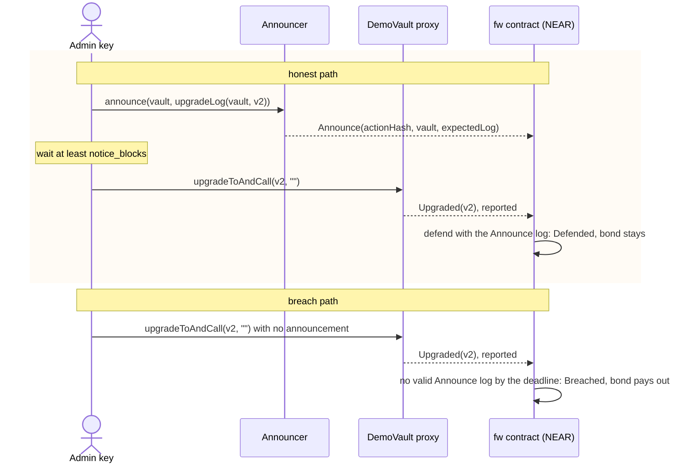

<div align="center">
<picture>
  <source media="(prefers-color-scheme: light)" srcset="../../web/public/brand/mark-light.png" />
  
</picture>

# Fair Warning · Base contracts

### The public notice board, and the demo vault whose admin key is being policed.

`Announcer` is where a team gives notice: one `Announce` log that commits to the exact log a future admin action will emit. `DemoVault` is a UUPS USDC vault whose owner key can upgrade it instantly. The NEAR `fw` contract reads both through the MPC network.

<br/>


-2ea44f)


**[Root README](../../README.md)** · **[Live run](../../README.md#the-full-lifecycle-step-by-step-with-a-real-example)** · **[Deployed contracts](../../README.md#live-deployment)** · **[NEAR contract](../near/README.md)** · **[For AI reviewers](../../AGENTS.md)**

</div>

---

## Check it in one minute

Read-only calls against the live Base Sepolia deployment. Needs Foundry's `cast`, no key.

```bash
cast call 0xC7deE7fBB2c095eA1E321FDc31448b7678FF9B1a "version()(string)" --rpc-url https://sepolia.base.org
cast storage 0xC7deE7fBB2c095eA1E321FDc31448b7678FF9B1a 0x360894a13ba1a3210667c828492db98dca3e2076cc3735a920a3ca505d382bbc --rpc-url https://sepolia.base.org
cast call 0x1E4896b1042085921373aa7B136cE7C04803814f "upgradeLog(address,address)(bytes)" \
  0xC7deE7fBB2c095eA1E321FDc31448b7678FF9B1a 0xcAa17c275910781A661F54D1B12EA4c8331a964b --rpc-url https://sepolia.base.org
```

| Call | See (read 14 Nov 2026) |
|---|---|
| `version()` on the vault proxy | `"2"`: the proxy runs `DemoVaultV2` |
| ERC-1967 implementation slot | `0x…caa17c275910781a661f54d1b12ea4c8331a964b`, the V2 implementation |
| `upgradeLog(proxy, V2)` on the Announcer | `0xc7dee7fb…f9b1a` ++ `bc7cd75a…2d3b` (the `Upgraded` topic) ++ the padded V2 address: 84 bytes, the same bytes the live `announce` call carried |

---

## Contracts

### `src/Announcer.sol`

The protocol's public notice board. `Ownable`; only the owner (the admin key) can announce.

| Member | What it does |
|---|---|
| `announce(target, expectedLog)` | Emits `Announce(actionHash, target, expectedLog)` and returns `actionHash = keccak256(expectedLog)`. `onlyOwner` |
| `event Announce(bytes32 indexed actionHash, address indexed target, bytes expectedLog)` | Topic 0 is `keccak256("Announce(bytes32,address,bytes)")` = `0xca1cdcd38b74c0372e7cd907ed543eb3e47f868a4f1f89ad553627c2b104601e` |
| `error AnnouncerLogTargetMismatch(address target)` | `expectedLog` is shorter than 52 bytes, or its first 20 bytes are not `target` |
| `upgradeLog(proxy, newImpl)` | `expectedLog` for a UUPS upgrade: `proxy ++ UPGRADED_TOPIC ++ bytes32(newImpl)` |
| `ownershipLog(target, prevOwner, newOwner)` | `expectedLog` for an Ownable ownership transfer |
| `roleGrantedLog(target, role, account, sender)` | `expectedLog` for an AccessControl role grant |
| `UPGRADED_TOPIC`, `OWNERSHIP_TOPIC`, `ROLE_GRANTED_TOPIC` | `keccak256` of `Upgraded(address)`, `OwnershipTransferred(address,address)`, `RoleGranted(bytes32,address,address)` |

**`expectedLog` format.** Emitter address (20 bytes) ++ topics ++ data of the log the admin action will emit. NEAR computes the same `keccak256(emitter ++ topics ++ data)` over the MPC-attested breach log, so an announcement matches exactly one log.

**What NEAR checks in an `Announce` log** (`check_defence` in the [NEAR contract](../near/README.md#how-the-mpc-call-works)): emitted by the commitment's `announcer`; `topics[1]` equals the breach's action hash; `data` ABI-decodes to `expectedLog` with the same hash; `topics[2]` is the breach emitter; and the announcement is at least `notice_blocks` and at most `max_announce_age_blocks` before the breach.

### `src/DemoVault.sol`

A minimal USDC vault behind a UUPS proxy. Its owner key is the admin power Fair Warning polices.

| Member | What it does |
|---|---|
| `initialize(owner_, asset_)` | Sets the owner (who can upgrade) and the deposit token. The implementation constructor calls `_disableInitializers()` |
| `deposit(amount)` | Pulls `amount` with `safeTransferFrom` after an approval. Reverts `DemoVaultZeroAmount` on 0. `nonReentrant` |
| `withdraw(amount)` | Sends back up to the caller's balance. Reverts `DemoVaultInsufficientBalance(balance, amount)`. `nonReentrant` |
| `version()` | `"1"` |
| `_authorizeUpgrade` | `onlyOwner`: the single key that can call `upgradeToAndCall` |
| `DemoVaultV2` | The "new code" for the demo upgrade. Identical except `version()` returns `"2"` |

Built on OpenZeppelin `UUPSUpgradeable`, `OwnableUpgradeable`, `ReentrancyGuardTransient` and `SafeERC20`. Events: `Deposit(user, amount)`, `Withdraw(user, amount)`. A UUPS upgrade emits `Upgraded(address)` from the proxy, the log the NEAR contract polices.

---

## Honest path vs breach path



---

## Scripts

All three commands sign with the admin key from the Foundry keystore `fw-admin`. `base` and `base_sepolia` are RPC aliases in `foundry.toml`; the live run used Base Sepolia (chain 84532).

**Deploy** the vault implementation, an `ERC1967Proxy` initialized with the admin and USDC, and an `Announcer` owned by the admin. `USDC_ADDRESS` is read from the environment (Base mainnet: `0x833589fCD6eDb6E08f4c7C32D4f71b54bdA02913`).

```bash
USDC_ADDRESS=0x.. forge script script/Deploy.s.sol --rpc-url base --account fw-admin --broadcast --verify
```

See: `vault proxy`, `vault impl `, `announcer  ` and `deploy block` printed. The printed `deploy block` is the simulated block, not the block the transaction lands in. Set the commitment's `effective_from_block` after the real deployment block, or the proxy's own deployment logs count as a breach (live case 0).

**Step 1, honest path: `AnnounceUpgrade`.** Deploys `DemoVaultV2` and announces the upgrade to it.

```bash
VAULT=0x.. ANNOUNCER=0x.. forge script script/Actions.s.sol:AnnounceUpgrade --rpc-url base --account fw-admin --broadcast
```

See: `new impl <address>` and the `actionHash`. Wait N blocks, then run step 2 with that address.

**Step 2: `Upgrade`.** The upgrade itself. Without step 1 (or before N blocks) this is the staged "leaked key" breach. If `NEW_IMPL` is unset it deploys a fresh `DemoVaultV2`.

```bash
VAULT=0x.. NEW_IMPL=0x.. forge script script/Actions.s.sol:Upgrade --rpc-url base --account fw-admin --broadcast
```

See: `upgraded to <address> version 2`.

---

## Setup and test

Dependencies are installed from pinned tags (see `foundry.lock`), not committed:

```bash
cd contracts/base
forge install foundry-rs/forge-std OpenZeppelin/openzeppelin-contracts@v5.7.0 OpenZeppelin/openzeppelin-contracts-upgradeable@v5.7.0 --no-git
forge test
```

See: 9 tests pass, including a 256-run fuzz test that an announced action hash equals the hash of the real upgrade log.

All tests are in `test/FairWarning.t.sol` (`FairWarningBaseTest`, with a 6-decimal `MockUSDC`).

| Test | Proves |
|---|---|
| `test_topicConstants` | The `Upgraded` and `Announce` topic hashes the NEAR contract and tests hard-code are correct |
| `test_announcedActionHashMatchesRealUpgradeLog` | The announced `actionHash` equals `keccak256(emitter ++ topics ++ data)` of the real `Upgraded` log, emitted by the proxy with empty data; `version()` becomes `"2"` |
| `test_announceLogShape` | `Announce` is emitted by the Announcer with 3 topics: the event topic, `actionHash`, the padded target |
| `test_ownershipTransferFingerprint` | `ownershipLog` matches the real `OwnershipTransferred` log |
| `test_onlyOwnerAnnouncesAndUpgrades` | A non-owner can neither announce nor upgrade |
| `test_announceRejectsLogForOtherTarget` | An `expectedLog` for another emitter reverts with `AnnouncerLogTargetMismatch` |
| `test_vaultCustomErrors` | `DemoVaultZeroAmount` and `DemoVaultInsufficientBalance` |
| `test_depositWithdraw` | Deposit 60, withdraw 10, balance 50 |
| `testFuzz_fingerprintIsGeneric(bytes32 salt)` | For any CREATE2-deployed `DemoVaultV2`, the announced hash equals the real upgrade log's fingerprint (256 runs) |

**Toolchain.** Foundry 1.8.3, solc 0.8.30 (sources declare `pragma solidity ^0.8.24`), EVM `cancun`, optimizer on with 200 runs. OpenZeppelin Contracts and Contracts Upgradeable 5.7.0. RPC endpoints and the explorer key come from `BASE_RPC_URL`, `BASE_SEPOLIA_RPC_URL` and `ETHERSCAN_API_KEY` (see `foundry.toml`).

---

## Live deployment (Base Sepolia)

| Contract | Address |
|---|---|
| DemoVault proxy | [`0xC7deE7fBB2c095eA1E321FDc31448b7678FF9B1a`](https://sepolia.basescan.org/address/0xC7deE7fBB2c095eA1E321FDc31448b7678FF9B1a) |
| Announcer | [`0x1E4896b1042085921373aa7B136cE7C04803814f`](https://sepolia.basescan.org/address/0x1E4896b1042085921373aa7B136cE7C04803814f) |
| DemoVaultV2 implementation (current) | [`0xcAa17c275910781A661F54D1B12EA4c8331a964b`](https://sepolia.basescan.org/address/0xcAa17c275910781A661F54D1B12EA4c8331a964b) |
| DemoVault implementation (original) | [`0x78377c5ce10afb3b7ec503e6da0e9441e9557761`](https://sepolia.basescan.org/address/0x78377c5ce10afb3b7ec503e6da0e9441e9557761) |

| Transaction | What it is | Outcome on NEAR |
|---|---|---|
| [`0xdad6cbe5…9a220`](https://sepolia.basescan.org/tx/0xdad6cbe51214d83999bb90573ebcabd00b1ba0a7f1d679e1c1289103a6c9a220) | Proxy deployment, block 57,047,306. Its `Upgraded` and `OwnershipTransferred` logs came after commitment 0's start block 57,047,143 | Case 0 `Paid`, case 1 `Moot` |
| [`0xd8c86857…8c86`](https://sepolia.basescan.org/tx/0xd8c86857bf63bab02388c783cbfc619040e19e5133ede3158e67e55804678c86) | Alice deposits 12 USDC | Paid 10.8 USDC from case 0 |
| [`0xbca535c7…4215`](https://sepolia.basescan.org/tx/0xbca535c79a9ead9507a0cffa45a089d9e776efb74425681d9fb3be3a783b4215) | Bob deposits 8 USDC | Paid 7.2 USDC from case 0 |
| [`0x0ccbe3a9…1cd2`](https://sepolia.basescan.org/tx/0x0ccbe3a9ee3e9c8c8ecd85c216c4431e46a2aeb803ae991abde1ca94cceb1cd2) | `announce(vault, upgradeLog(vault, V2))`, block 57,048,073 | The defence for case 2 |
| [`0xcb1de237…f4d5`](https://sepolia.basescan.org/tx/0xcb1de237695c58ee7fb95129565890501f559318307f823b94ec8f627a89f4d5) | `upgradeToAndCall(V2, "")`, block 57,048,538, 465 blocks after the announcement | Case 2 `Defended` |
| [`0x5c3aa5b2…5f30`](https://sepolia.basescan.org/tx/0x5c3aa5b23a44c18e33025fc4f4f2fc9d0e78bf646d18d1f58a8737382bf75f30) | Unannounced upgrade, block 57,481,268, 12 Nov 2026 | Cases 3 and 4 `Paid`, one per bond |

The vault, the admin key and both depositors are ours. Testnet USDC has no value.
