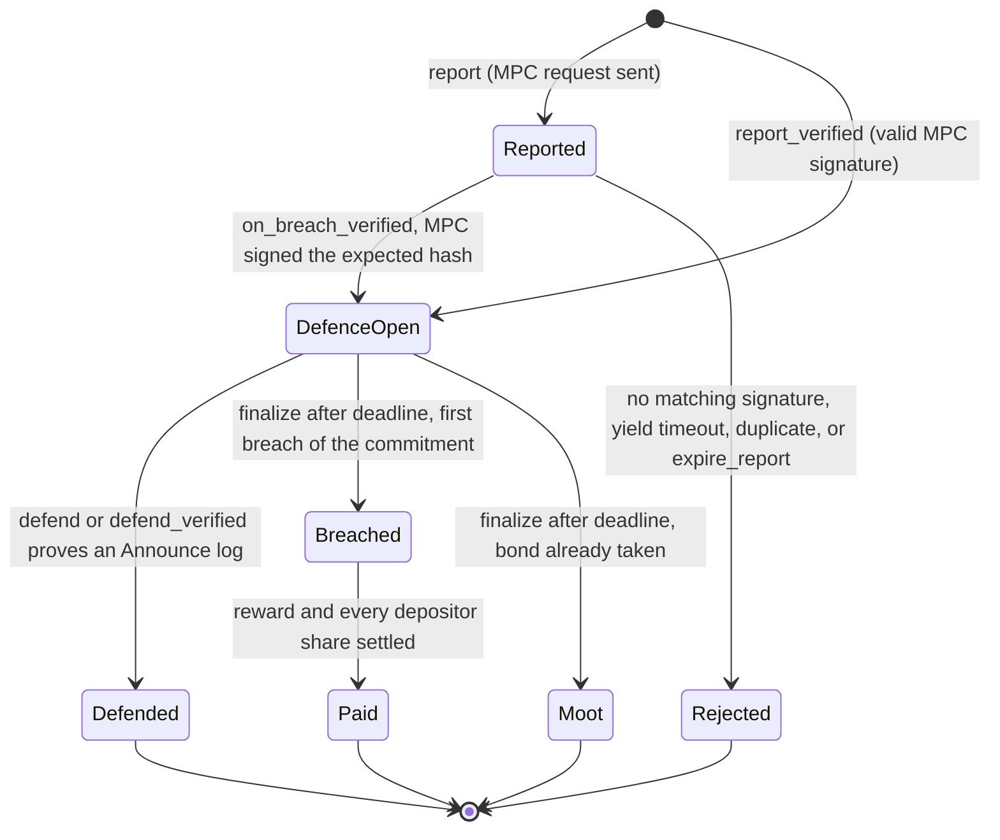
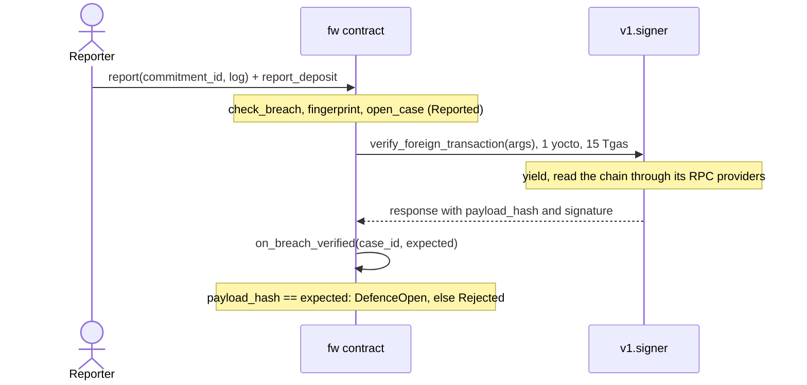

<div align="center">
<picture>
  <source media="(prefers-color-scheme: light)" srcset="../../web/public/brand/mark-light.png" />
  
</picture>

# Fair Warning · NEAR contract

### A notice-or-pay bond on NEAR, settled by the MPC network reading the EVM log itself.

The `fw` contract holds a team's USDC bond, opens a case when anyone reports an unannounced admin log on a watched EVM contract, asks `v1.signer` to confirm that exact log, lets anyone defend with an earlier `Announce` log, and pays the reporter and depositors if nobody can.

<br/>


-ffd9a0)


**[Root README](../../README.md)** · **[Check it yourself](../../README.md#try-it-in-two-minutes)** · **[Live run](../../README.md#the-full-lifecycle-step-by-step-with-a-real-example)** · **[Deployed contracts](../../README.md#live-deployment)** · **[Base contracts](../base/README.md)** · **[For AI reviewers](../../AGENTS.md)**

</div>

---

## Check it in one minute

No keys, no installs. Each command reads the live contract `fw-fw-7ab26a.testnet`.

```bash
q() { curl -s https://rpc.testnet.near.org -H 'content-type: application/json' \
  -d "{\"jsonrpc\":\"2.0\",\"id\":1,\"method\":\"query\",\"params\":{\"request_type\":\"call_function\",\"finality\":\"final\",\"account_id\":\"fw-fw-7ab26a.testnet\",\"method_name\":\"$1\",\"args_base64\":\"$2\"}}" \
  | python3 -c 'import sys,json;print(bytes(json.load(sys.stdin)["result"]["result"]).decode())'; }

q config e30=                                   # {}
q get_case eyJjYXNlX2lkIjowfQ==                 # {"case_id":0}
q is_covered eyJjb21taXRtZW50X2lkIjozfQ==       # {"commitment_id":3}
q report_deposit eyJjb21taXRtZW50X2lkIjozfQ==   # {"commitment_id":3}
```

| Call | See (read 14 Nov 2026) |
|---|---|
| `config` | `["v1.signer-prod.testnet","3e2210e1…b8af","secp256k1:2KGCoy2p…32qj1",5,5]`: MPC account, USDC token, MPC key, next commitment id, next case id |
| `get_case` 0 | `"status":"Paid"`, `"reward":"2000000"`, `"pool":"18000000"`, `"claims":2`, `"reward_paid":true` |
| `is_covered` 3 | `true` |
| `report_deposit` 3 | `"110000000000000000000000"` (0.1 NEAR report bond plus the 0.01 NEAR storage fee) |

---

## What the contract does

1. **Commit.** Anyone calls `create_commitment` and becomes its owner. The commitment names the chain, up to 4 watched addresses, up to 8 admin event topics, the `Announcer` address, `notice_blocks`, the defence window and the withdrawal notice.
2. **Bond.** The owner sends USDC with `ft_transfer_call` and msg `{"commitment_id":N}`. The owner commits a Merkle root of depositor balances with `set_root`.
3. **Report.** Anyone calls `report(commitment_id, log)` with the report deposit. The contract checks the log against the commitment, opens a `Reported` case and asks `v1.signer` to verify the log.
4. **Defend.** While the case is `DefenceOpen`, anyone calls `defend(case_id, announce_log)`. If the MPC network confirms an `Announce` log for the same action, at least `notice_blocks` before the breach, the case is `Defended`.
5. **Pay.** After the deadline, anyone calls `finalize`. The bond is seized: `reward_bps` of it goes to the reporter via `claim_reward`, the rest is the depositor pool, paid through `claim` against the Merkle root and an EIP-191 signature.

Key files: `contract/src/lib.rs` · `contract/src/merkle.rs`

---

## Case state machine



`CaseStatus`: `Reported`, `DefenceOpen`, `Defended`, `Breached`, `Paid`, `Rejected`, `Moot`.

`CommitmentStatus`: `Committed`, `Breached`, `Closed`. `finalize` moves a commitment from `Committed` to `Breached`; no method in this version sets `Closed`.

**Where the report bond goes.** The case stores the attached deposit minus the 0.01 NEAR storage fee as `report_bond`.

| Outcome | Report bond goes to |
|---|---|
| `Rejected` | Reporter (refund) |
| `Defended` | Defender, whoever proved the notice |
| `Breached` | Reporter (refund), plus the USDC reward |
| `Moot` | Reporter (refund) |

**Payout math.** At `finalize`: `reward = bond * reward_bps / 10_000`, `pool = bond - reward`. A depositor's share is `amount * pool / root.total`. The running sum of shares (`reserved`) can never exceed `pool`. A case becomes `Paid` only when nothing is left in flight: the reward settled, every leaf claimed, and the leftover below one unit of rounding per claim.

---

## Public methods

Deposit column: "1 yocto" means exactly 1 yoctoNEAR, enforced by `assert_one_yocto`, so only a full-access key can call it.

| Method | Caller | Deposit | What it does |
|---|---|---|---|
| `new(mpc, usdc, mpc_key)` | Deployer (init) | none | Sets the MPC account, the USDC token and the MPC public key. Panics unless `mpc_key` parses as secp256k1 |
| `create_commitment(params)` | Anyone, becomes owner | at least 0.05 NEAR | Validates `CommitmentParams` (rules below), stores the commitment, returns its id |
| `ft_on_transfer(sender_id, amount, msg)` | USDC contract only | via `ft_transfer_call` | Bond top-up. `msg` must be `{"commitment_id":N}`; the commitment must be `Committed` |
| `set_root(commitment_id, root)` | Owner | 1 yocto | First root applies at once. A later root is pending until `now + max(root_notice, withdrawal_notice + grace)` |
| `apply_root(commitment_id)` | Anyone | none | Applies the pending root once its notice is over and no case is open |
| `request_withdrawal(commitment_id, amount)` | Owner | 1 yocto | Schedules a withdrawal at `now + withdrawal_notice + grace`. Coverage ends at once |
| `cancel_withdrawal(commitment_id)` | Owner | 1 yocto | Drops the pending withdrawal |
| `execute_withdrawal(commitment_id)` | Owner | 1 yocto | Sends the bond back after the delay, only while `Committed` with no open case. Restores the bond if the transfer fails |
| `report(commitment_id, log)` | Anyone | at least `report_deposit` | Checks the log, opens a `Reported` case, calls `v1.signer.verify_foreign_transaction` |
| `report_verified(commitment_id, log, response)` | Anyone | at least `report_deposit` | Fallback A: verifies a `v1.signer` response locally against the MPC key, opens and activates the case in one call |
| `expire_report(case_id)` | Anyone | none | Rejects and refunds a case still `Reported` more than 250 blocks after the report |
| `defend(case_id, log)` | Anyone | none (not payable) | Checks the `Announce` log, calls `v1.signer` to verify it |
| `defend_verified(case_id, log, response)` | Anyone | none (not payable) | Fallback A for the defence: local MPC signature check, closes the case as `Defended` |
| `finalize(case_id)` | Anyone | none | After the deadline, with no defence in flight (or the last one older than 250 blocks): `Breached` for the first breach, `Moot` for later ones |
| `claim_reward(case_id)` | Anyone, pays the reporter | at least 0.00125 NEAR | Pays the reporter's reward in USDC. The deposit funds the recipient's USDC storage |
| `claim(case_id, base_address, amount, proof, pay_to, signature)` | Anyone (relayer) | at least 0.00125 NEAR | Verifies the Merkle proof for `(base_address, amount)` and an EIP-191 signature by `base_address` over the claim message for `pay_to`, then pays the share |

Private callbacks: `on_breach_verified`, `on_defence_verified`, `on_paid`, `on_withdrawn`.

**`CommitmentParams` rules** (`create_commitment` panics otherwise):

| Field | Rule |
|---|---|
| `chain` | One of `Base`, `Arbitrum`, `Bnb`, `Polygon`, `Avalanche`, `HyperEvm`, `Abstract`. Defaults to `Base` |
| `watched` | 1 to 4 20-byte addresses |
| `watched_topics` | 1 to 8 32-byte topics |
| `announcer` | A 20-byte address |
| `notice_blocks`, `max_announce_age_blocks` | `notice_blocks > 0` and `max_announce_age_blocks >= notice_blocks` (EVM blocks) |
| `defence_window` | At least 300 NEAR blocks, to outlive one MPC yield (200 blocks) |
| `withdrawal_notice` | At least `defence_window` |
| `root_notice` | At least `withdrawal_notice` plus the finality grace |
| `reward_bps` | At most 5,000 (50%) |
| `effective_from_block`, `finality`, `report_bond` | Logs before `effective_from_block` cannot be reported. `finality` is `Safe` or `Finalized` |

**Claim message.** The depositor signs, with `personal_sign`, exactly the string `claim_message_for(case_id, pay_to)` returns:

```
Fair Warning claim
contract: <fw account>
case: <case_id>
pay_to: <NEAR account>
```

---

## Views

| View | Returns |
|---|---|
| `is_covered(commitment_id)` | `true` only if `Committed`, bond above 0, root set, no withdrawal pending and no root change pending |
| `report_deposit(commitment_id)` | Exact deposit `report` and `report_verified` need: `report_bond` plus 0.01 NEAR |
| `get_commitment(commitment_id)` | The `Commitment`, or `null` |
| `get_case(case_id)` | The `Case`, or `null` |
| `case_for_log(commitment_id, tx_hash, log_index)` | The case that verified this log for this commitment, if any |
| `mpc_request_for(log, chain, finality)` | The exact `VerifyForeignTransactionRequestArgs` the contract sends to `v1.signer`, including `expected_payload_hash`. Clients use it for fallback A |
| `claim_message_for(case_id, pay_to)` | The message a depositor signs |
| `config()` | `(mpc, usdc, mpc_key, next_commitment, next_case)` |

---

## Events (NEP-297)

Standard `fair_warning`, version `1.0.0`, logged as `EVENT_JSON:`. The backend settles payouts from the claim transaction's own events.

| Event | Fields |
|---|---|
| `commitment_created` | `commitment_id`, `owner` |
| `bond_deposited` | `commitment_id`, `amount`, `bond` |
| `root_set` | `commitment_id`, `root`, `total`, `active_at` |
| `withdrawal_requested` | `commitment_id`, `amount`, `available_at` |
| `withdrawal_cancelled` | `commitment_id` |
| `withdrawn` | `commitment_id`, `amount` |
| `reported` | `case_id`, `commitment_id`, `tx_hash`, `log_index`, `reporter` |
| `report_rejected` | `case_id`, `reason` (`mpc did not confirm`, `duplicate`, `expired`) |
| `defence_opened` | `case_id`, `breach_block`, `action_hash`, `deadline` |
| `defence_submitted` | `case_id`, `defender`, `announce_block` |
| `defence_rejected` | `case_id`, `defender` |
| `defended` | `case_id`, `defender`, `announce_block` |
| `breached` | `case_id`, `commitment_id`, `reward`, `pool` |
| `paid` | `case_id`, `recipient`, `amount`, `kind` (`reward` or `depositor`) |
| `payout_failed` | `case_id`, `recipient`, `amount`, `kind` |

---

## Constants

| Constant | Value | Why |
|---|---|---|
| `FOREIGN_TX_DOMAIN` | `3` | MPC domain for foreign transaction verification |
| `MPC_GAS` / `CALLBACK_GAS` | 15 Tgas / 25 Tgas | `verify_foreign_transaction` call and its callback |
| `FT_GAS` / `STORAGE_GAS` | 10 Tgas / 5 Tgas | USDC transfer and storage registration |
| `COMMITMENT_STORAGE` | 0.05 NEAR | Minimum deposit for `create_commitment` |
| `REPORT_STORAGE_FEE` | 0.01 NEAR | Non-refundable part of every report. Pays for the case, its verified-log entry and the root copied at finalize |
| `FT_STORAGE` | 0.00125 NEAR | USDC `storage_balance_bounds` on NEAR; attached to every payout |
| `MAX_LOG_DATA_HEX` | 8,194 chars | Bound on `log.data` |
| `MAX_PROOF_LEN` | 64 | Bound on a Merkle proof |
| `STUCK_AFTER` | 250 blocks | MPC yield times out at 200; after 250 a stuck report or defence can be cleared |
| `WITHDRAW_GRACE_SAFE` | 600 blocks | Grace after `withdrawal_notice` for `Safe` finality. Base `safe` lags the tip by up to about 1 min |
| `WITHDRAW_GRACE_FINALIZED` | 3,000 blocks | Same for `Finalized`. Base `finalized` lags by about 17 min |
| `ANNOUNCE_TOPIC` | `ca1cdcd3…601e` | `keccak256("Announce(bytes32,address,bytes)")` |
| `reward_bps` cap | 5,000 | Reporter reward at most 50% of the bond. The live commitments use 1,000 (10%) |

---

## How the MPC call works



1. **Build the request.** `build_request` uses the official `near-mpc-sdk` builder for the commitment's chain (`new_base`, `new_arbitrum`, `new_bnb`, `new_polygon`, `new_avalanche`, `new_hyper_evm`, `new_abstract`) with the tx id, the finality, the expected log at its index and domain 3. It returns a `ForeignChainSignatureVerifier` and the request args, including `expected_payload_hash`.
2. **Send with yield/resume.** `report` and `defend` call `verify_foreign_transaction` with 1 yoctoNEAR and chain a callback that carries the hex `expected_payload_hash`. The MPC network yields for up to 200 blocks.
3. **Accept only the exact hash.** `on_breach_verified` and `on_defence_verified` read the raw promise result (at most 4,096 bytes) without `#[callback_result]`, so a changed response shape returns `false` instead of panicking. The case opens only if `payload_hash` equals the expected hash. A timeout or an error result rejects and refunds the report.
4. **Late answers change nothing.** `on_breach_verified` returns `false` for a case no longer `Reported`. `close_defended` requires `DefenceOpen`, so a defence answer after `finalize` is a no-op.
5. **Fallback A.** `report_verified` and `defend_verified` take a `VerifyForeignTransactionResponse` the caller got from `v1.signer` directly, and check it with `verifier.verify_signature` against the `mpc_key` set at init. Same checks, no callback needed.
6. **One case per log per commitment.** A verified log is stored under `"{commitment_id}:{tx_hash}:{log_index}"`, so a decoy commitment on the same vault cannot consume the log and shield the real bond. Entries from before the security upgrade sit under the legacy key `"{tx_hash}:{log_index}"` and count only for the commitment of the case they point to.

**What a report must carry.** `log` is one EVM log exactly as `eth_getTransactionReceipt` returns it: `tx_hash`, `log_index`, `transaction_index`, `block_hash`, `block_number`, `address`, `data`, `topics`. `data` must be lowercase `0x` hex, because the MPC network signs the RPC's raw `data` string. The emitter must be watched, `topics[0]` must be a watched topic, and `block_number` must be at least `effective_from_block`.

**The action fingerprint.** `action_hash = keccak256(emitter ++ topics ++ data)` of the breach log. The `Announcer` on the EVM side commits to the same value (see [Base contracts](../base/README.md)).

**What a defence must carry.** An `Announce` log from the commitment's `announcer` with 3 topics, where:
- `topics[0]` is `ANNOUNCE_TOPIC` and `topics[1]` equals the case's `action_hash`;
- `data` ABI-decodes to `bytes expectedLog` and `keccak256(expectedLog)` equals `action_hash`;
- `topics[2]` is the first 20 bytes of `expectedLog`, the breach emitter;
- `announce_block + notice_blocks <= breach_block` and `breach_block - announce_block <= max_announce_age_blocks`.

Key files: `contract/src/lib.rs` (`report`, `defend`, `on_breach_verified`, `on_defence_verified`, `build_request`, `check_breach`, `check_defence`, `fingerprint`) · `contract/src/merkle.rs` (`leaf_hash`, `verify_proof`, `eip191_signer`)

---

## Invariants and the test that proves each

From [AGENTS.md](../../AGENTS.md). Tests in `sandbox-tests/tests/fair_warning.rs` unless marked `audit_poc.rs`.

| # | Invariant | Test |
|---|---|---|
| 1 | A case pays out only if the MPC network signed the exact expected payload hash for the reported log | `breach_without_notice_pays_reporter_and_depositors`, `wrong_claim_times_out_and_refunds`, `fallback_a_direct_signature_path` |
| 2 | A valid `Announce` log at least `notice_blocks` before the breach, and at most `max_announce_age_blocks`, defends the case | `honest_upgrade_is_defended_and_reporter_bond_goes_to_defender`, `defence_rules_notice_action_window`, `defence_must_carry_the_announced_log_and_its_target` |
| 3 | The bond cannot leave before `withdrawal_notice` plus the finality grace, and never while a case is open. A pending withdrawal makes `is_covered` false | `bond_withdrawal_needs_notice_and_no_open_case`, `withdrawal_waits_for_notice_plus_grace_and_ends_coverage`, `root_swap_needs_the_withdrawal_notice` (`audit_poc.rs`) |
| 4 | A depositor claim needs the depositor's EIP-191 signature over `pay_to`; a relayer cannot redirect it, and a leaf pays once | `claims_cannot_replay_or_redirect` |
| 5 | Payouts of a case never exceed that case's pool, whatever `root.total` the owner committed | `a_lying_root_total_cannot_drain_other_bonds` |
| 6 | Every report leaves 0.01 NEAR with the contract for the storage it creates (559 bytes measured per full case) | `reports_pay_their_storage_and_owner_calls_need_full_access` |
| 7 | Owner methods (`set_root`, `request_withdrawal`, `cancel_withdrawal`, `execute_withdrawal`) need exactly 1 yoctoNEAR | `reports_pay_their_storage_and_owner_calls_need_full_access` |
| 8 | A commitment's chain is part of the MPC request; a signature for the same log on another chain cannot open a case | `the_commitment_chain_binds_the_mpc_answer` |

**The other tests.**

| Test | Proves |
|---|---|
| `report_input_checks_and_duplicates` | Wrong emitter, wrong topic, a block before coverage, uppercase data and a short deposit are refused; a verified log cannot be reported twice |
| `only_first_breach_takes_the_bond` | Two breaches on one commitment: the first is `Breached`, the second `Moot` |
| `expire_report_only_after_mpc_timeout` | `expire_report` refuses within the MPC timeout and has nothing to do once the timeout path cleaned up |
| `a_failed_payout_never_marks_the_case_paid` | A failed transfer leaves the case `Breached` and the reward claimable again |
| `two_commitments_on_one_log_both_open_cases` (`audit_poc.rs`, F1 fixed) | A decoy commitment on the same proxy cannot consume the breach log; both cases open and the real bond is slashed |
| `late_breach_callback_changes_nothing` (`audit_poc.rs`, F3 fixed) | A breach callback for a case no longer `Reported` changes nothing and refunds nothing twice |
| `poc_fake_report_freezes_withdrawal` (`audit_poc.rs`, F4 deferred) | Passing means the weakness is still present: see [known limits](#known-limits) |

Unit tests in `contract/src/lib.rs`: `paid_waits_for_in_flight_payouts`, `paid_needs_every_leaf_and_allows_only_dust`, `abi_bytes_round_trip_and_strictness`.

---

## Build and test

Prerequisites: Rust via rustup (`rust-toolchain.toml` pins 1.97.1 with clippy, rustfmt and `wasm32-unknown-unknown`), `cargo-near` 0.22.0.

**1. Build the three wasm files.** The sandbox tests load them from `target/near/<name>/<name>.wasm`.

```bash
cd contracts/near
for c in mock-signer mock-ft contract; do (cd $c && cargo near build non-reproducible-wasm --no-abi); done
```

**2. Run the sandbox tests.**

```bash
cd sandbox-tests && cargo test -- --test-threads=4
```

See: `test result: ok. 16 passed` for `fair_warning.rs` and `test result: ok. 4 passed` for `audit_poc.rs` (2 to 7 minutes; the timeout and withdrawal tests fast-forward up to 1,000 blocks).

**3. Lint.**

```bash
cd contracts/near/contract && cargo clippy --target wasm32-unknown-unknown -- -D warnings
```

See: exit 0.

**Sandbox setup.** Each test deploys `mock_signer`, `mock_ft` and `fair_warning`, then creates commitment 0 with `notice_blocks` 30, `max_announce_age_blocks` 500, `defence_window` 300, `withdrawal_notice` 400, `root_notice` 1,000, `report_bond` 0.5 NEAR and `reward_bps` 1,000, a two-leaf root (Alice 60, Bob 40) and a 500 USDC bond. A breach therefore pays 50 USDC to the reporter, 270 to Alice and 180 to Bob.

**Release profile** (workspace `Cargo.toml`): `opt-level = "z"`, `lto = true`, `codegen-units = 1`, `panic = "abort"`, `overflow-checks = true`.

### Reproducible build

Configured in `contract/Cargo.toml` under `[package.metadata.near.reproducible_build]`:

| Key | Value |
|---|---|
| `image` | `sourcescan/cargo-near:0.22.0-rust-1.97.1` |
| `image_digest` | `sha256:7467038bdddc86484b73b416eeadce926ff59013e128e53dec5a19e1cb4b2234` (binding; the tag is descriptive) |
| `container_build_command` | `cargo near build non-reproducible-wasm --locked --no-abi` |

`cargo near build reproducible-wasm` also needs `repository` set to the public repo URL and a clean, pushed git tree. `Cargo.lock` is tracked for this reason. The testnet wasm was built with `cargo near build non-reproducible-wasm`; mainnet will use the reproducible build.

---

## Test doubles

| Crate | Stands in for | Behaviour |
|---|---|---|
| `mock-signer` | `v1.signer` | Same `verify_foreign_transaction(request)` method and args. Requires at least 1 yoctoNEAR, at least 15 Tgas and domain 3. Creates a yield (`promise_yield_create`) keyed by `expected_payload_hash`. The test harness plays the MPC network by calling `respond(response)`, signed with a known secp256k1 key; a response whose hash has no pending request panics, like `UnexpectedPayloadHash`. A yield that is never answered times out and `on_response` panics with `timeout`. `public_key` returns the configured key |
| `mock-ft` | Circle USDC | The near-contract-standards NEP-141 example: `ft_transfer`, `ft_transfer_call`, storage management. Refuses a transfer whose sender and receiver are the same account, which `a_failed_payout_never_marks_the_case_paid` relies on |

---

## Live deployment

| Surface | Where |
|---|---|
| `fw` contract (NEAR testnet) | [`fw-fw-7ab26a.testnet`](https://testnet.nearblocks.io/address/fw-fw-7ab26a.testnet) |
| Code hash | `2Tuu83XL97AmVMmAZdSiz5o6o9yBGH96HqtHoBovF7F9`, deployed by the security upgrade [`8gBmfmsV…9HYZ`](https://testnet.nearblocks.io/txns/8gBmfmsVQd2Hsz7Btagkypg2YECWBw7YM5qftZYb9HYZ). Cases 0 to 2 ran on the previous code `H5mJNsj1…uUrkt` |
| MPC network | `v1.signer-prod.testnet` (near/mpc 3.18.0), domain 3 key `secp256k1:2KGCoy2p…32qj1` |
| Bond token | Circle USDC on NEAR testnet, `3e2210e1184b45b64c8a434c0a7e7b23cc04ea7eb7a6c3c32520d03d4afcb8af` (6 decimals) |
| Commitments | 0, 1, 2: breached and paid out. 3 and 4: covered, 2 USDC each, policing the same Base Sepolia vault |
| Cases | 0: `Paid`. 1: `Moot`. 2: `Defended`. 3 and 4: `Paid` (one log, two bonds, two independent reporters) |
| Accounts | owner `fw-owner-7ab26a.testnet`, watcher `fw-watch-7ab26a.testnet` |

Every transaction of the run is linked in the [root README lifecycle](../../README.md#the-full-lifecycle-step-by-step-with-a-real-example).

**Dependencies.** near-sdk 5.29.1 (feature `unstable`), near-contract-standards 5.29.1, near-mpc-sdk from `github.com/near/mpc` rev `d0fc87b1` (tag 3.17.0; wire types unchanged in 3.18.0), `hex` 0.4. Sandbox tests use near-workspaces 0.23.0 and `k256` for the MPC and EIP-191 keys.

---

## Known limits

- **One unanswerable report freezes the bond for one MPC timeout.** A report for a fabricated tx on a watched address and topic costs the reporter 0.01 NEAR plus gas, and blocks `execute_withdrawal` and `apply_root` until the 200-block yield times out and the case is rejected. Deferred finding F4, `poc_fake_report_freezes_withdrawal`.
- **The depositor root is committed by the team.** A rogue team can commit a bad root in advance. It is public, a change waits `root_notice` and cannot apply while a case is open, and each case's payouts are capped at its own pool.
- **Only the admin events a team declares are policed.** A `setOracle` call or a fee switch outside `watched_topics` is invisible.
- **Read MPC is new and moving.** The contract pins the 3.17.0 SDK types, unchanged in 3.18.0. Fallback A is kept in case contract callbacks change.
- **Liveness depends on the MPC network's RPC providers.** It needs 2 of its 3 whitelisted providers per chain to agree. An outage delays a verdict; it cannot fake one.
- **Notice is counted in EVM blocks, the defence window in NEAR blocks.** There are no timestamps.
- **Coverage ends when a withdrawal is requested.** The bond leaves only after `withdrawal_notice` plus 600 (`Safe`) or 3,000 (`Finalized`) NEAR blocks, so a breach from before the notice ended can still be proven.
- **`effective_from_block` must be after the vault's deployment.** Otherwise the deployment's own `Upgraded` and `OwnershipTransferred` logs are reportable breaches, which is what live case 0 was.
- **The bond is a penalty, not insurance.** The team chooses its size.
