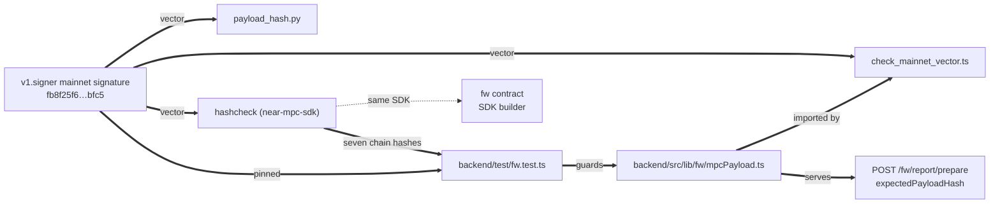

<div align="center">
<picture>
  <source media="(prefers-color-scheme: light)" srcset="../web/public/brand/mark-light.png" />
  
</picture>

# Fair Warning · Tools

### Rebuild the hash the MPC network signs, three ways.

Three independent encoders for the payload `v1.signer` signs in `verify_foreign_transaction`. Each one is checked against a hash the MPC network actually signed on mainnet, and the Rust one against the official near-mpc SDK types for all seven EVM chains.

<br/>


**[Root README](../README.md)** · **[Try it in two minutes](../README.md#try-it-in-two-minutes)** · **[The payload encoder](../README.md#an-independent-payload-encoder)** · **[Backend](../backend/README.md)** · **[For AI reviewers](../AGENTS.md)**

</div>

---

## Why this matters

A case opens only if the MPC network signed the exact expected payload hash for the reported log (invariant 1 in [AGENTS.md](../AGENTS.md)). That hash is `sha256(borsh(ForeignTxSignPayload::V1 { request, values }))`. Borsh has no field names and no schema in the bytes, so one wrong enum index or byte order gives a valid-looking hash that the MPC network never signs. The report then times out and refunds, and nobody can tell why.

The contract builds its request with the official SDK. The backend has to predict the same hash on its own: `POST /fw/report/prepare` shows it to the reporter before they sign. This folder proves both sides agree, against a signature the MPC network really produced.

## Do X, see Y

| Do | See |
|:-|:-|
| `cd tools && bun install && bun run check` | `computed` equal to `mpc_said` (`fb8f25f6…bfc5`) from TypeScript, then again from Python; exit 0 |
| `cd tools/hashcheck && cargo run --release` | `computed=fb8f25f6…bfc5`, then the single-log `Safe` hash for each of the seven chains |
| `cd backend && bun test test/fw.test.ts` (env as in [backend tests](../backend/README.md#tests)) | 7 pass: the same hashes pinned, offline |

---

## The mainnet vector

Taken from the code comments in `check_mainnet_vector.ts` and `backend/test/fw.test.ts`: `v1.signer` signed this payload hash for log 5 of a real Base transaction, in a NEAR mainnet receipt on 25 Oct 2026 (NEAR tx `AkeQab…`).

| Field | Value |
|:-|:-|
| Base tx | `0x702705ea9058b4a16a8907d06075de2ce65087da8061f93655e9a056e60a9301` |
| Block | 53,056,155, hash `0x39da995c…576549` |
| Log | index 5, transaction index 3, emitter `0xe844701934d9c6085b292e428f41b911cc0b3872`, data `0x`, 2 topics |
| Request | chain `Base`, finality `Finalized`, extractors `[BlockHash, Log { log_index: 5 }]` |
| Signed payload hash | `fb8f25f6b7bad4ff91af67a7e43f06aaa6653923c8fa6e39d741f220418bbfc5` |

`fw.report` asks a different question: one `Log` extractor at the commitment's finality, with no `BlockHash`. For the same log on Base at `Safe` that hash is `7a48b522c192d3ec4845c58aed1d9a8afc50bfbdf0511329aaa6cc3eaa7745b7`. Every encoder below produces both.

---

## The three encoders

| Encoder | File | Source of the bytes | Reads the log from | Checks |
|:-|:-|:-|:-|:-|
| TypeScript | `check_mainnet_vector.ts` | Imports `backend/src/lib/fw/mpcPayload.ts`, the encoder the backend runs | `eth_getTransactionReceipt` on `https://mainnet.base.org` | Mainnet vector; prints the `Safe` hash; exits 1 on mismatch |
| Python | `payload_hash.py` | Its own borsh writer, standard library only | `eth_getTransactionReceipt` on `https://mainnet.base.org` | Mainnet vector on Base; exits 1 on mismatch |
| Rust | `hashcheck/src/main.rs` | `near-mpc-sdk` types and `ForeignChainRequestBuilder` (git rev `d0fc87b`), the SDK the contract uses | Hard-coded fields, no network | Mainnet vector via `compute_msg_hash`, builder output, and the `Safe` hash for all seven chains |

The TypeScript and Python checks fetch the receipt live, so the log fields come from the chain, not from a fixture. The Python script sends its own `User-Agent` because the default one is refused with 403.

### Borsh layout

What all three encode, from `mpcPayload.ts` and `payload_hash.py`:

| Part | Encoding |
|:-|:-|
| Payload version | `u8` 0 (`V1`) |
| Chain | `u8` variant index: Abstract 0, Bnb 5, Base 6, Arbitrum 7, Polygon 8, HyperEvm 9, Avalanche 13 |
| Tx id | 32 bytes |
| Extractors | `u32` count, then `BlockHash` = `u8` 0, `Log` = `u8` 1 + `u64` log index |
| Finality | `u8`: Latest 0, Safe 1, Finalized 2 |
| Values | `u32` count, each `u8` 1 (`Evm`), then `BlockHash` = `u8` 0 + 32 bytes, or `Log` = `u8` 1 + log |
| Log | `removed` `u8`, `log_index` `u64`, `transaction_index` `u64`, tx hash, block hash, `block_number` `u64`, 20-byte address, `data` as a `u32`-length UTF-8 string of the hex, `u32` topic count, topics |

Integers are little-endian. `data` is the RPC's lowercase hex string, not its decoded bytes. The Rust check prints `borsh_len=272 prefix=0006702705ea9058` for the mainnet vector: `00` is `V1`, `06` is Base, then the tx hash.

---

## Run it

Prerequisites: Bun and `python3` for `bun run check`; Rust 1.97.1 (pinned in `hashcheck/rust-toolchain.toml`) for `hashcheck`. Both TypeScript and Python need outbound HTTPS to `mainnet.base.org`.

```bash
cd tools && bun install && bun run check
```

```
computed: 0xfb8f25f6b7bad4ff91af67a7e43f06aaa6653923c8fa6e39d741f220418bbfc5
mpc_said: 0xfb8f25f6b7bad4ff91af67a7e43f06aaa6653923c8fa6e39d741f220418bbfc5
single-log Safe (what fw.report asks for): 0x7a48b522c192d3ec4845c58aed1d9a8afc50bfbdf0511329aaa6cc3eaa7745b7
computed fb8f25f6b7bad4ff91af67a7e43f06aaa6653923c8fa6e39d741f220418bbfc5
mpc_said fb8f25f6b7bad4ff91af67a7e43f06aaa6653923c8fa6e39d741f220418bbfc5
```

See: exit 0. The first three lines are TypeScript, the last two Python. `bun run check` runs Python only if TypeScript passed.

```bash
cd tools/hashcheck && cargo run --release
```

```
borsh_len=272 prefix=0006702705ea9058
computed=fb8f25f6b7bad4ff91af67a7e43f06aaa6653923c8fa6e39d741f220418bbfc5
mpc_said=fb8f25f6b7bad4ff91af67a7e43f06aaa6653923c8fa6e39d741f220418bbfc5
builder single-log Safe=7a48b522c192d3ec4845c58aed1d9a8afc50bfbdf0511329aaa6cc3eaa7745b7
request json={...}
chain Base=7a48b522c192d3ec4845c58aed1d9a8afc50bfbdf0511329aaa6cc3eaa7745b7
chain Arbitrum=43abbfc425906779a235037e96222d47733033ee839c280e952cbd0d8f1ecb5c
chain Bnb=8eb56790a92258f176e3577d79f170193e3bc7b885711c5f2e19d334847e324d
chain Polygon=e70e930b79d0f9a2e4f15663637d4897705bc35f37683c428a3044af49c715c9
chain Avalanche=6372b8e40c2f78f19576b295caa6c21082e271ef32a893e31d16814a88786484
chain HyperEvm=4c91c42996d54837d74932a2a6b80b0c37b2b7c4378fc59b574a0525c08db68d
chain Abstract=afa5758965c9b2ec84fe1d29e2d95c8c47a116d7c668f08e72e39baf7ef8ace0
```

See: `computed` equals `mpc_said`, and the seven `chain` lines equal the table pinned in `backend/test/fw.test.ts`. `request json` is the full `verify_foreign_transaction` argument the SDK builds (shortened here). The first build fetches `near-mpc-sdk` from GitHub at the pinned rev.

---

## How it ties to the backend



- **`mpcPayload.ts` is under test, not a copy.** `check_mainnet_vector.ts` imports `expectedPayloadHash` and `toLogInput` from `backend/src/lib/fw/mpcPayload.ts`, so the live check exercises the exact code the backend runs.
- **`fw.test.ts` keeps it pinned offline.** It asserts the mainnet hash (`Base`, `Finalized`, with block hash), the SDK builder's single-log `Safe` hash, the `hashcheck` output for all seven chains, and that changing any field changes the hash. These run in the backend's `76 pass`.
- **The SDK side matches the contract.** `hashcheck` uses `ForeignChainRequestBuilder`, the builder the `fw` contract uses in `build_request` (see the [root README](../README.md#read-mpc-v1signerverify_foreign_transaction)). If the TypeScript hash matches the builder's for every chain, the hash the reporter sees is the hash the contract will accept.

Key files: `tools/check_mainnet_vector.ts` · `tools/payload_hash.py` · `tools/hashcheck/src/main.rs` · `backend/src/lib/fw/mpcPayload.ts` · `backend/test/fw.test.ts`

---

## Limits

- **Python checks Base only.** Its chain table stops at HyperEvm; the seven-chain comparison is the Rust check plus `fw.test.ts`.
- **The Rust check prints, it does not assert.** Compare `computed` with `mpc_said` by eye; `fw.test.ts` is the assertion.
- **One vector.** The only MPC-signed hash here is a `Finalized` request with a `BlockHash` extractor. The `Safe` single-log hashes are checked against the SDK, not against a mainnet signature. The live testnet cases in the [root README](../README.md#the-full-lifecycle-step-by-step-with-a-real-example) were opened by `v1.signer-prod.testnet` signing single-log requests that the contract built with the same SDK builder.
- **Wire types are pinned.** `CHAIN_INDEX` in `mpcPayload.ts` follows near-mpc 3.17.0 and 3.18.0. A new chain variant upstream needs a new index here and a new pinned hash.
