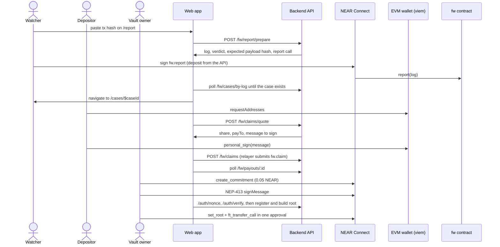
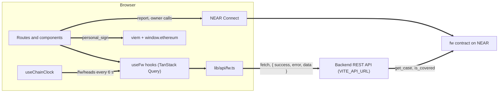

<div align="center">
<picture>
  <source media="(prefers-color-scheme: light)" srcset="public/brand/mark-light.png" />
  
</picture>

# Fair Warning · Web app

### Watch a vault's notice clock, report a silent upgrade, claim your share.

The browser side of Fair Warning. Watchers report unannounced admin logs through their NEAR wallet, depositors claim payouts with one EIP-191 signature from the address they deposited from, and vault owners post a bond in three wallet prompts. Every number on screen comes from the backend indexer or straight from the `fw` contract; nothing is mocked.

<br/>


**[Project README](../README.md)** · **[Try it in two minutes](../README.md#try-it-in-two-minutes)** · **[Run the whole stack](../README.md#run-locally)** · **[Architecture](../README.md#architecture)** · **[Live deployment](../README.md#live-deployment)** · **[For AI reviewers](../AGENTS.md)**

</div>

---

## Check it yourself

| Do | See |
|---|---|
| `bun install && bunx tsc --noEmit` | exit 0 |
| `bun dev`, open http://localhost:3200 with the backend stopped | `/bonds` shows an **Indexer unreachable** panel with a **Try again** button, not an empty list |
| Start the backend against testnet (root README, [Run locally](../README.md#run-locally) step 5), reload | The nav chip counts `Base #…` upward between polls; the bonded total appears next to it |
| Open `/cases/0` | Title **Paid out in full.**, a five-station track filled to Payout, the reporter reward and depositor pool read from `get_case` |
| Open `/cases/2` | Title **Defended. The bond stays.** |
| On `/report`, click any **Try a real one** chip | A receipt with the verdict pill and the payload hash the MPC network will sign, decoded left to right. No wallet needed |
| Open `/cases/abc` or `/nope` | **No case by that number.** and the 404 page **Nothing on this stretch of coast.** |

`/cases/$caseId` works even for cases your local indexer never saw: the backend reads `get_case` from the contract on every request and returns it as `chain`, and the page prefers it over the indexed row.

---

## Pages

| Route | What a user does | What they see |
|---|---|---|
| `/` | Reads the story, scrolls | A one-time splash that counts to 100 while Base is read (click to skip), a WebGL lighthouse hero, the **notice clock** set by the newest real announcement from `/fw/announcements/latest`, a pinned scroll diagram with two tabs (a breach, an honest upgrade), and four guarantees the contract enforces |
| `/bonds` | Browses every bonded vault | Live totals (bonded USDC, vaults covered, open cases, paid to users), up to 12 vaults drawn as lamps on one coastline (lit while covered, red once breached), the ledger, and recent cases |
| `/bonds/$slug` | Inspects one vault | Chain, vault and Announcer links, notice in blocks and time, finality, defence window, bond, owner. A live `NoticeDial` for the newest unused announcement. A timeline of every announcement and admin log; a breach without a case links to `/report?tx=…` |
| `/report` | Pastes a transaction hash, signs `fw.report` | A receipt per policed log: event, emitter, block, finality, the verdict (`No notice found`, `Announced in time`, `Not classified yet`) and the expected payload hash |
| `/cases/$caseId` | Follows a case; depositors claim | A five-station track (Admin log, MPC reads the chain, Defence window, verdict, Payout), a countdown to the window close in NEAR blocks, payouts with their status, and the claim panel once the case is `Breached` |
| `/bond/new` | An owner fills one form and runs five steps | The form on the left, a live `NoticeDial` previewing the promise and the step rail on the right |
| 404 | Lands on an unknown path | `[404]` **Nothing on this stretch of coast.** with links to `/bonds`, `/report` and `/` |

Unhandled render errors go to `src/components/ErrorPage.tsx` (message, **Try again**, **Go home**).

Key files: `src/routes/` · `src/components/landing/Landing.tsx` (`beam.ts` WebGL hero, `flow.ts` pinned diagram) · `src/components/fw/NotFound.tsx`

The `[02]` diagram on `/` is a scripted explainer (a 500 USDC bond, a 300-block window, 10% and 90% splits). Its hash prefix `fb8f25f6b7bad4ff` is the real mainnet payload hash rebuilt in `tools/`. Everything else on the page reads live data.

---

## Three roles, three wallet flows



### Watcher: report a breach
1. **Paste.** `/report` accepts a hash only if it is `0x` plus 64 hex characters (`isTxHash`). `?tx=` prefills it.
2. **Read the receipt.** The backend finds every policed log in the transaction and returns the exact `fw.report` call (contract, method, args, deposit, gas). The page shows the hash the MPC network must sign.
3. **Wait if needed.** For `Safe` finality the button stays disabled until the chain's safe head passes the log's block, and the page says how long. A log the watcher classed as `announced` needs the **Report anyway and risk the bond** checkbox.
4. **Sign.** NEAR Connect signs one function call. The page then polls `/fw/cases/by-log/...` every 2 s (up to 30 tries) and opens the case.

### Depositor: claim a share
1. **Pick where to receive:** a NEAR account, USDC on Base, or USDC on Solana. The address is validated before anything is sent (`isNearAccount`, `isEvmAddress`, `isSolAddress`).
2. **Connect.** The page asks the injected EVM wallet (`window.ethereum`) for an address. No chain switch, no transaction.
3. **Check the share.** `/fw/claims/quote` returns the deposit at snapshot, the share, who gets paid and the message to sign. On testnet the Base and Solana routes return a real mainnet 1Click quote marked as a dry run; nothing is signed and the page offers **Claim to a NEAR account** instead.
4. **Sign.** `personal_sign` (EIP-191) over the quoted message, then `POST /fw/claims`. The contract re-checks the signature, so the relayer cannot redirect the payout. The payout rail moves through `queued`, `submitted`, `paid`, and `bridged` for 1Click routes.

### Owner: post a bond
`/bond/new` runs five steps behind three wallet prompts:

| Step | Call | Wallet prompt |
|---|---|---|
| Create the commitment | `fw.create_commitment`, 0.05 NEAR storage, 30 Tgas | yes |
| Sign in as the owner | NEP-413 `signMessage` against `/auth/nonce`, checked by `/auth/verify` | yes, no transaction |
| Register the vault | `POST /fw/protocols` with the JWT | no |
| Commit the depositor list | `POST /fw/protocols/$slug/root` builds the Merkle root | no |
| Set the root and post the bond | `fw.set_root` and USDC `ft_transfer_call`, 1 yoctoNEAR each, one `signAndSendTransactions` | yes |

- **Start block from the live head.** `effective_from_block` is the chain clock's current head, so a vault's own deployment logs are never policed.
- **Hours become blocks** at the chain's measured block time from `/fw/chains`. The form will not submit for a chain with no measurement yet.
- **Form rules mirror the contract:** defence window at least 300 NEAR blocks; announcements valid at least as long as the notice; withdrawal notice longer than the defence window; depositor list notice at least the withdrawal notice plus the finality grace (600 NEAR blocks for `Safe`, 3,000 for `Finalized`); reporter reward 0 to 50%; one `0xaddress, amount` per line, each address once.
- **Defaults:** Base, 24 h notice, announcements valid 30 days, `Safe`, 18 min defence window, 7 day withdrawal notice, 169 h list notice, 0.5 NEAR report bond, 10% reward, 500 USDC bond.
- **Resumable.** The commitment id, slug and form are kept in `sessionStorage` (`fw-bond-draft`), so a refresh between prompts continues from the last finished step.

Key files: `src/routes/report.tsx` · `src/routes/cases/$caseId.tsx` · `src/routes/bond/new.tsx` · `src/lib/near/wallet.ts` (`callContract`, `callContracts`, `signNep413`) · `src/lib/evm/wallet.ts` (`requestEvmAddress`, `signWithEvm`) · `src/hooks/useNearAccount.ts`

---

## Data flow



- **One client.** `src/lib/api/fw.ts` types every route the pages use. A response without `success: true` throws `ApiError(message, code, status)`.
- **Polling, not sockets.** Refresh intervals in `src/hooks/useFw.ts`:

| Data | Route | Interval |
|---|---|---|
| Chain heads | `/fw/heads` | 6 s |
| A vault, cases, one case, one payout | `/fw/protocols/$slug`, `/fw/cases`, `/fw/cases/$id`, `/fw/payouts/$id` | 4 s |
| Stats, vault list | `/fw/stats`, `/fw/protocols` | 15 s |
| Recent admin logs, latest announcement | `/fw/admin-events`, `/fw/announcements/latest` | 30 s |
| Chains and measured block times | `/fw/chains` | stale after 10 min |

  A case stops polling once it is `Defended`, `Paid`, `Rejected` or `Moot` with no payout still in flight. A payout stops at `bridged` or `failed`.
- **The live chain clock.** `useChainClock()` extrapolates Base (0.2 s per block) and NEAR (0.6 s per block) forward from the last `/fw/heads` read and never steps backwards when the next read lands. Other chains show the last polled head. The nav chip, footer and dials read it through refs every 200 ms, so the block number counts without re-rendering React.
- **Contract state wins.** On a case page every fact prefers the `get_case` result (`chain`) over the indexed row.

Key files: `src/lib/api/fw.ts` · `src/hooks/useFw.ts` · `src/components/fw/NoticeDial.tsx`

### Never mock data
When the backend fails, pages render `<Offline>` (`src/components/fw/States.tsx`) with the real error and a retry, never placeholder rows. The eyebrow reads **Indexer unreachable** for a network failure, **Indexer error** for a 5xx, and a specific title for `NO_ADMIN_LOG`, `INVALID_TX_HASH` and `BASE_RPC_ERROR`. While loading, pages show `<Skeleton>` rows and `…`, not zeros.

---

## Design system

All tokens live in `src/styles.css`. The theme is a `dark` or `light` class on `<html>`; dark is the default.

| Token | Dark | Light | Use |
|---|---|---|---|
| `--bg` | `#000000` | `#fbfbfa` | Page |
| `--fg` / `--fg-2` / `--fg-3` | `#f2f2f0` / `#9a9a96` / `#5e5e5a` | `#0b0b0c` / `#56575c` / `#94959a` | Text tiers |
| `--light` | `#ffd9a0` | `#d4730c` | The single accent: every lit thing, focus rings, selection, progress line |
| `--mark` | `#fdb57a` | `#b45f08` | Logo color |
| `--ok` / `--bad` | `#5fd3a0` / `#ff7a6b` | `#0f8a5c` / `#d23f2f` | Covered or defended / breach |

- **Type.** Instrument Sans for text, Instrument Serif italic for one key phrase per heading (`.serif`), JetBrains Mono for numbers and labels (`.mono`, `.eyebrow`). All three load from `@fontsource`.
- **Tailwind 4.** `@theme inline` maps the tokens to utilities (`bg-bg`, `text-fg-2`, `text-light`, `font-mono`). Design classes in `src/styles.css` and `src/styles/*.css` sit inside `@layer components`, so utilities override them.
- **Logo.** `public/brand/mark.png` is painted through a CSS mask (`.logo-mark`) filled with `--mark`, so one asset serves both themes.
- **Theme before paint.** An inline script in `src/routes/__root.tsx` reads `localStorage.theme` and sets the class before first paint; `ThemeProvider` keeps it in sync.
- **Shared pieces.** `<Cta>` (flat pill, label roll and arrow swap on hover, 0.97 press), `<PageHead>` (heading split into masked lines that keep the gradient), `<NoticeDial>`, `<StatusPill>`, `<HashReveal>`.

Key files: `src/styles.css` · `src/styles/app.css` · `src/styles/landing.css` · `src/components/fw/`

## Motion

- **GSAP in a context.** ScrollTrigger, SplitText and MotionPathPlugin are registered once (`src/lib/motion.ts`). Every animation runs inside `gsap.context` and is reverted in the effect cleanup.
- **Lenis drives scroll.** One Lenis instance (`lerp: 0.085`) ticks on GSAP's ticker and updates ScrollTrigger. On each route change the page jumps to the top and ScrollTrigger re-measures after 300 ms.
- **`prefers-reduced-motion` is respected everywhere.** No Lenis (native scroll keeps the progress line), no splash, no split headings, `HashReveal` prints the hash at once, `NoticeDial` redraws once a second instead of every frame, and CSS transitions on buttons and odometers are off.
- **Off-screen dials pause.** `NoticeDial` stops drawing when its canvas leaves the viewport.

Key files: `src/lib/motion.ts` · `src/lib/lenis.ts` · `src/providers/LenisSmoothScrollProvider.tsx`

---

## Environment

Copy `.env.example` to `.env`. Vite inlines `VITE_*` values at build time.

| Variable | Default when unset | What it sets |
|---|---|---|
| `VITE_API_URL` | `http://localhost:3700` | Backend base URL (the backend's default `APP_PORT`) |
| `VITE_NEAR_NETWORK` | mainnet | `testnet` switches NEAR Connect, the MPC id (`v1.signer-prod.testnet`), nearblocks and every EVM explorer link to testnets. Any other value means mainnet |
| `VITE_FW_CONTRACT_ID` | `fw.fairwarning.near` | The `fw` contract the app calls |
| `VITE_USDC_CONTRACT_ID` | native USDC on NEAR mainnet (`17208628…6133a1`) | Token for `ft_transfer_call` bonds |
| `VITE_ANNOUNCER_ADDRESS` | empty | Prefills the Announcer field on `/bond/new` |
| `VITE_GITHUB_URL` | `https://github.com/capinhoooo/fairwarning` | Footer **Source** link |
| `DEVTOOLS_PORT` | `42069` | Port of the TanStack devtools event bus in `bun dev` (read by `vite.config.ts`) |

For the live testnet deployment use `VITE_NEAR_NETWORK=testnet`, `VITE_FW_CONTRACT_ID=fw-fw-7ab26a.testnet` and the Circle testnet USDC id from the [root README](../README.md#live-deployment).

Key files: `src/config.ts` · `.env.example` · `vite.config.ts`

---

## Commands

```bash
bun install
bun dev            # http://localhost:3200
bun run build      # production build into .output/
bun lint           # ESLint (@tanstack/eslint-config)
bunx tsc --noEmit  # strict typecheck
```

If another TanStack app already holds the devtools bus on 42069, move this one:

```bash
DEVTOOLS_PORT=42070 bun dev
```

## Docker

`Dockerfile` builds with `oven/bun:1.4.4-slim` and runs the Nitro server on `node:24.9.0-slim` as the `node` user. Pass the `VITE_*` values as build args, since they are inlined at build time. Nitro reads `PORT` at runtime.

```bash
docker build -t fair-warning-web \
  --build-arg VITE_API_URL=http://localhost:3700 \
  --build-arg VITE_NEAR_NETWORK=testnet \
  --build-arg VITE_FW_CONTRACT_ID=fw-fw-7ab26a.testnet \
  --build-arg VITE_USDC_CONTRACT_ID=<testnet USDC id> \
  .
docker run -p 3000:3000 -e PORT=3000 fair-warning-web
```

`.dockerignore` keeps `.env` and `.env.*` out of the build context.

---

## Project structure

```
web/
├── public/brand/            # mark.png, mark-light.png, favicons
├── src/
│   ├── routes/              # __root, index, bonds/index, bonds/$slug, report, cases/$caseId, bond/new
│   ├── components/
│   │   ├── fw/              # Nav, Footer, Cta, PageHead, NoticeDial, StatusPill, HashReveal, States, NotFound
│   │   └── landing/         # Landing.tsx, beam.ts (WebGL hero), flow.ts (pinned diagram)
│   ├── hooks/               # useFw (queries, useChainClock), useNearAccount
│   ├── lib/                 # api/fw.ts, near/wallet.ts, evm/wallet.ts, lenis.ts, motion.ts
│   ├── providers/           # Theme, HeroUI, Lenis (also draws the grain and the progress line)
│   ├── utils/               # fw.ts (units, durations, explorer links, validators), style.ts
│   ├── config.ts            # network, contract ids, explorers
│   └── styles.css           # tokens and shared classes
├── Dockerfile
└── vite.config.ts
```

---

## Security

- **One `dangerouslySetInnerHTML`.** Only the static theme bootstrap script in `src/routes/__root.tsx`; it contains no user data.
- **External links** open in a new tab with `rel="noopener noreferrer"` (`Cta`, footer, vault, report and case pages; the landing's one explorer link uses `rel="noreferrer"`, which implies `noopener`).
- **Input is validated before any request or signature** (`src/utils/fw.ts`): tx hashes, EVM, NEAR and Solana addresses, USDC amounts (positive, at most 6 decimals) and NEAR amounts (at most 24 decimals). Case ids must be digits before the page queries them.
- **The JWT stays in memory.** The owner's session token from NEP-413 sign-in is never written to storage; the `sessionStorage` draft holds only the commitment id, slug and form.
- **Owner calls attach exactly 1 yoctoNEAR**, so the contract only accepts them from a full-access key.
- **Depositor claims are bound to the signer.** The web app only forwards the signature; the contract checks it against the Merkle leaf, so neither the relayer nor this app can change `pay_to`.
- **No secrets in the bundle.** Every `VITE_*` value is a public id or URL.

## License

MIT, see [LICENSE](../LICENSE).
